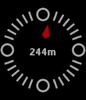
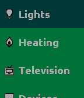

<!-- Generated by scripts/update_app_directory.py: do not edit by hand -->
[← All Pebble Developers](../developers.md)

# kennedn

*2 apps · Last updated 2026-10-11 · [About these lists](../about-app-lists.md)*

Links: [Rebble App Store](https://apps.rebble.io/en_US/developer/5eac48e120940a03976c6b05/1) · [GitHub (kennedn)](https://github.com/kennedn) · [Website (kennedn.com)](https://kennedn.com/)

<button type="button" data-filter="all" aria-pressed="true">All 2</button><button type="button" data-filter="watchface" aria-pressed="false" disabled>Watchfaces 0</button><button type="button" data-filter="watchapp" aria-pressed="false">Apps 2</button>

<label class="dev-sort">Sort by <select><option value="updated">Recently updated</option><option value="released">Newest release</option><option value="title">A–Z</option></select></label>

<h2 class="app-name" id="app-637ae1c6c6c24a000a815eb2"><a href="https://apps.rebble.io/en_US/application/637ae1c6c6c24a000a815eb2">find-o-matic</a> v1.4</h2>
<a class="app-source" href="https://github.com/kennedn/find-o-matic/" title="Source code" data-search-exclude>View source</a>

App

Released 2022-11-21 Updated 2023-02-20 Rebble App Store

Runs on: Round 2, Time 2, Pebble 2 Duo, Pebble 2, Time Round, Time, Classic

A compass that points at the thing you desire most. Be it booze, a big mac or anything in between. Uses the DuckDuckGo Nearest Places API to drive a compass pointer. Configure a search term in the…

<h2 class="app-name" id="app-6242c8b5f13e30000921d65a"><a href="https://apps.rebble.io/en_US/application/6242c8b5f13e30000921d65a">Stateful</a> v1.4</h2>
<a class="app-source" href="https://github.com/kennedn/Stateful" title="Source code" data-search-exclude>View source</a>

App

Released 2022-03-29 Updated 2022-07-12 Rebble App Store

Runs on: Round 2, Time 2, Pebble 2 Duo, Pebble 2, Time Round, Time, Classic

Automate with state! Stateful is a watch app with one goal: to make interacting with IoT devices and RESTful API&#x27;s as seamless as possible. At its core, Stateful has the ability to send arbitrary…

