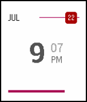

<!-- Generated by scripts/update_app_directory.py: do not edit by hand -->
[← All Pebble Developers](../developers.md)

# Kenny Chen

*1 watchface · Last updated 2026-10-11 · [About these lists](../about-app-lists.md)*

Links: [Pebble App Store](https://apps.repebble.com/apps/dev/kenny-chen_530c50a87cd17ca525000271) · [GitHub (kenny-chen)](https://github.com/kenny-chen)

<h2 class="app-name" id="app-55a96f5427eb8ded4c000006"><a href="https://apps.repebble.com/55a96f5427eb8ded4c000006">Path Reborn</a> v1.4</h2>
<a class="app-source" href="https://github.com/kenny-chen/pebble-path-reborn" title="Source code" data-search-exclude>View source</a>

Watchface

Released 2015-07-17 Updated 2015-09-17

Runs on: Time 2, Pebble 2 Duo, Pebble 2, Time, Classic

A modified version of the Path watch face by corefault for the Pebble Time, with the seconds bar as a battery bar instead, the minutes moved to the side for easier reading, and a slight increase…

