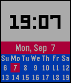

<!-- Generated by scripts/update_app_directory.py: do not edit by hand -->
[← All Pebble Developers](../developers.md)

# Kenny

*1 watchface · Last updated 2026-10-11 · [About these lists](../about-app-lists.md)*

Links: [Pebble App Store](https://apps.repebble.com/apps/dev/kenny_550c6b9edeb0ad13ce00002d) · [GitHub (kennydo)](https://github.com/kennydo)

<h2 class="app-name" id="app-55ee43ca2b0b31d03c000083"><a href="https://apps.repebble.com/55ee43ca2b0b31d03c000083">Sakuya</a> v1.0</h2>
<a class="app-source" href="https://github.com/kennydo/sakuya-watchface" title="Source code" data-search-exclude>View source</a>

Watchface

Released 2015-09-08 Updated 2015-09-08

Runs on: Time 2, Time

A simple watchface that shows you the time, the date, and a small calendar.

