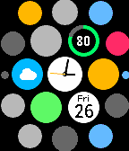

<!-- Generated by scripts/update_app_directory.py: do not edit by hand -->
[← All Pebble Developers](../developers.md)

# KENZ

*1 watchface · Last updated 2026-10-12 · [About these lists](../about-app-lists.md)*

Links: [Pebble App Store](https://apps.repebble.com/apps/dev/kenz_5575c40abea9ccece200004e) · [GitHub (kenz-gelsoft)](https://github.com/kenz-gelsoft)

<h2 class="app-name" id="app-5589df9efb51554a7e000025"><a href="https://apps.repebble.com/5589df9efb51554a7e000025">@WATCH</a> v1.9</h2>
<a class="app-source" href="https://github.com/kenz-gelsoft/atWATCH.git" title="Source code" data-search-exclude>View source</a>

Watchface

Released 2015-06-23 Updated 2015-07-26

Runs on: Time 2, Pebble 2 Duo, Pebble 2, Time, Classic

Watchface inspired by Apple&#x27;s one. You can watch time, calendar, battery and weather at a glance. By shaking your watch you can look at current time easily.

