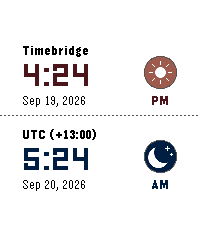

<!-- Generated by scripts/update_app_directory.py: do not edit by hand -->
[← All Pebble Developers](../developers.md)

# keshavpratap

*1 watchface and 1 app · Last updated 2026-10-12 · [About these lists](../about-app-lists.md)*

Links: [Pebble App Store](https://apps.repebble.com/apps/dev/keshavpratap_e0bc7ee30a038907b7d48939) · [GitHub (KeshavPratap-K)](https://github.com/KeshavPratap-K) · [Website (keshav.contact)](https://keshav.contact)

<button type="button" data-filter="all" aria-pressed="true">All 2</button><button type="button" data-filter="watchface" aria-pressed="false">Watchfaces 1</button><button type="button" data-filter="watchapp" aria-pressed="false">Apps 1</button>

<label class="dev-sort">Sort by <select><option value="updated">Recently updated</option><option value="released">Newest release</option><option value="title">A–Z</option></select></label>

<h2 class="app-name" id="app-7cec9ebe19e84044b22d30da"><a href="https://apps.repebble.com/7cec9ebe19e84044b22d30da">Timebridge</a> v1.2.0</h2>
<a class="app-source" href="https://github.com/KeshavPratap-K/Timebridge-Watchapp" title="Source code" data-search-exclude>View source</a>

App

No licence Released 2026-09-19 Updated 2026-09-19

Runs on: Time 2, Pebble 2 Duo, Pebble 2, Time, Classic

🌍 Time Bridge — Compare local and global times at a glance, switch timezones instantly with the Up/Down buttons, and enjoy fun sun ☀️ and moon 🌙 icons. Browse recent zones, customize themes…

<h2 class="app-name" id="app-577f4d98fdfb41c3a8267fab"><a href="https://apps.repebble.com/577f4d98fdfb41c3a8267fab">Periodic Color</a> v1.5.0</h2>
<a class="app-source" href="https://github.com/KeshavPratap-K/Periodic-Color" title="Source code" data-search-exclude>View source</a>

Watchface

No licence Released 2026-09-18 Updated 2026-09-18

Runs on: Time 2, Pebble 2 Duo, Pebble 2, Time, Classic

This is a color updated version of classic Periodic watchface. Have your watch show the time in periodic entries with the Periodic watchface! The hour and time is displayed with the chemical…

