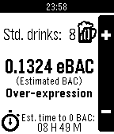
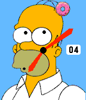

<!-- Generated by scripts/update_app_directory.py: do not edit by hand -->
[← All Pebble Developers](../developers.md)

# Kevin Conley

*1 watchface and 2 apps · Last updated 2026-10-11 · [About these lists](../about-app-lists.md)*

Links: [Pebble App Store](https://apps.repebble.com/apps/dev/kevin-conley_52ef236f282306c38f00000d) · [GitHub (kevincon)](https://github.com/kevincon)

<button type="button" data-filter="all" aria-pressed="true">All 3</button><button type="button" data-filter="watchface" aria-pressed="false">Watchfaces 1</button><button type="button" data-filter="watchapp" aria-pressed="false">Apps 2</button>

<label class="dev-sort">Sort by <select><option value="updated">Recently updated</option><option value="released">Newest release</option><option value="title">A–Z</option></select></label>

<h2 class="app-name" id="app-530db564ae03dcd9cf00024d"><a href="https://apps.repebble.com/530db564ae03dcd9cf00024d">SoberUp</a> v1.0.1</h2>
<a class="app-source" href="https://github.com/kevincon/SoberUp" title="Source code" data-search-exclude>View source</a>

App

Released 2014-02-26 Updated 2024-01-21

Runs on: Time 2, Pebble 2 Duo, Pebble 2, Time, Classic

Count your drinks, estimate your BAC, and learn about the effects of alcohol on your body.

<h2 class="app-name" id="app-56a727ff6178cf2f01000020"><a href="https://apps.repebble.com/56a727ff6178cf2f01000020">Goal Star</a> v1.1</h2>
<a class="app-source" href="https://github.com/kevincon/goal_star" title="Source code" data-search-exclude>View source</a>

App

Released 2016-01-26 Updated 2016-08-13

Runs on: Round 2, Time 2, Time Round, Time

A simple Pebble app that lets you set a daily health goal and get notified with vibrations and a popup when you reach it. Goal Star runs in the background so you can get notified even if you&#x27;re…

<h2 class="app-name" id="app-56340c46716fdbf1a600002c"><a href="https://apps.repebble.com/56340c46716fdbf1a600002c">Sprinkles</a> v1.2</h2>
<a class="app-source" href="https://github.com/kevincon/sprinkles" title="Source code" data-search-exclude>View source</a>

Watchface

Released 2015-10-31 Updated 2016-03-29

Runs on: Round 2, Time 2, Pebble 2 Duo, Pebble 2, Time Round, Time, Classic

An analog Homer Simpson watch face that supports every Pebble watch, from the Pebble Classic to the Pebble Time Round. Homer&#x27;s eyes follow a sprinkled donut on either the minute or seconds hand…

