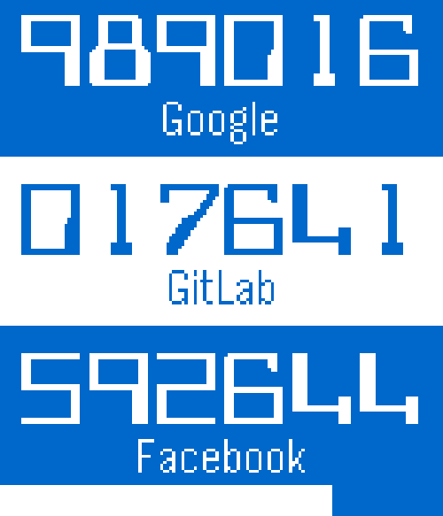
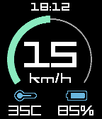

<!-- Generated by scripts/update_app_directory.py: do not edit by hand -->
[← All Pebble Developers](../developers.md)

# Kevin Cooper

*2 apps · Last updated 2026-10-12 · [About these lists](../about-app-lists.md)*

Links: [Pebble App Store](https://apps.repebble.com/apps/dev/kevin-cooper_52baa34daac062dcf400005c) · [GitHub (JumpMaster)](https://github.com/JumpMaster)

<button type="button" data-filter="all" aria-pressed="true">All 2</button><button type="button" data-filter="watchface" aria-pressed="false" disabled>Watchfaces 0</button><button type="button" data-filter="watchapp" aria-pressed="false">Apps 2</button>

<label class="dev-sort">Sort by <select><option value="updated">Recently updated</option><option value="released">Newest release</option><option value="title">A–Z</option></select></label>

<h2 class="app-name" id="app-53131df8bb31cf87cd00019a"><a href="https://apps.repebble.com/53131df8bb31cf87cd00019a">QuickAuth</a> v3.3</h2>
<a class="app-source" href="https://github.com/JumpMaster/QuickAuth" title="Source code" data-search-exclude>View source</a>

App

GPL-3.0 Released 2014-03-02 Updated 2016-11-30

Runs on: Round 2, Time 2, Pebble 2 Duo, Pebble 2, Time Round, Time, Classic

Get your one time codes from your Pebble! Just add your keys using the configuration page and use two-step authentication without the Google Authenticator application on your smart phone. Tested…

<h2 class="app-name" id="app-5793c91150c75291fa00026e"><a href="https://apps.repebble.com/5793c91150c75291fa00026e">WheelLog</a> v1.4</h2>
<a class="app-source" href="https://github.com/JumpMaster/WheelLogPebble" title="Source code" data-search-exclude>View source</a>

App

No licence Released 2016-07-23 Updated 2016-10-06

Runs on: Round 2, Time 2, Pebble 2 Duo, Pebble 2, Time Round, Time, Classic

A Dashboard for KingSong and Gotway electric unicycles.

