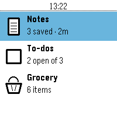
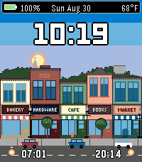

<!-- Generated by scripts/update_app_directory.py: do not edit by hand -->
[← All Pebble Developers](../developers.md)

# Keynes

*1 watchface and 1 app · Last updated 2026-10-11 · [About these lists](../about-app-lists.md)*

Links: [Pebble App Store](https://apps.repebble.com/apps/dev/keynes_b9f6a0b2865903bff0747a2b) · [GitHub (lordkeynes)](https://github.com/lordkeynes)

<button type="button" data-filter="all" aria-pressed="true">All 2</button><button type="button" data-filter="watchface" aria-pressed="false">Watchfaces 1</button><button type="button" data-filter="watchapp" aria-pressed="false">Apps 1</button>

<label class="dev-sort">Sort by <select><option value="updated">Recently updated</option><option value="released">Newest release</option><option value="title">A–Z</option></select></label>

<h2 class="app-name" id="app-ba09dc7f85b14dbc8319d9af"><a href="https://apps.repebble.com/ba09dc7f85b14dbc8319d9af">Dictate</a> v1.1.1</h2>
<a class="app-source" href="https://github.com/lordkeynes/Dictate_pebble" title="Source code" data-search-exclude>View source</a>

App

Released 2026-09-21 Updated 2026-09-21

Runs on: Round 2, Time 2, Pebble 2 Duo, Pebble 2, Time Round, Time

Note taking app built in the theme of the Pebble OS Stock weather app. Ability to store Note, To Do List, and a built in Grocery list.

<h2 class="app-name" id="app-2cd6eda817c142dd8467a9c8"><a href="https://apps.repebble.com/2cd6eda817c142dd8467a9c8">Pixel Town</a> v1.4.0</h2>
<a class="app-source" href="https://github.com/lordkeynes/Pixel_town" title="Source code" data-search-exclude>View source</a>

Watchface

Released 2026-08-30 Updated 2026-09-05

Runs on: Round 2, Time 2, Time

A pixel-art small-downtown watchface for Pebble, a full-screen scene whose sky, sun/moon arc, stars and weather all react to the time of day, real sunrise/sunset from Open-Meteo, and current…

