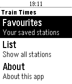

<!-- Generated by scripts/update_app_directory.py: do not edit by hand -->
[← All Pebble Developers](../developers.md)

# Kieron Quinn

*1 app · Last updated 2026-10-12 · [About these lists](../about-app-lists.md)*

Links: [Rebble App Store](https://apps.rebble.io/en_US/developer/587104f38006df1434000019/1) · [GitHub (KieronQuinn)](https://github.com/KieronQuinn) · [Website (kieronquinn.co.uk)](https://kieronquinn.co.uk)

<h2 class="app-name" id="app-58bb064b6ca387c7de000d57"><a href="https://apps.rebble.io/en_US/application/58bb064b6ca387c7de000d57">Train Times (GB)</a> v1.2</h2>
<a class="app-source" href="https://github.com/KieronQuinn/pebble-train-times-gb" title="Source code" data-search-exclude>View source</a>

App

GPL-3.0 Released 2017-03-04 Updated 2025-07-15 Rebble App Store

Runs on: Round 2, Time 2, Pebble 2 Duo, Pebble 2, Time Round, Time, Classic

Train Times on your pebble! This app displays train times for all National Rail stations in England, Scotland and Wales. Features: - Display departures and arrivals for a station - Get information…

