<!-- Generated by scripts/update_app_directory.py: do not edit by hand -->
[← All Pebble Developers](../developers.md)

# Kieselleger

*18 watchfaces and 3 apps · Last updated 2026-10-11 · [About these lists](../about-app-lists.md)*

Links: [Pebble App Store](https://apps.repebble.com/apps/dev/kieselleger_56f70d3fe58879cfd4000013) · [GitHub (ProggroP)](https://github.com/ProggroP)

<button type="button" data-filter="all" aria-pressed="true">All 21</button><button type="button" data-filter="watchface" aria-pressed="false">Watchfaces 18</button><button type="button" data-filter="watchapp" aria-pressed="false">Apps 3</button>

<label class="dev-sort">Sort by <select><option value="updated">Recently updated</option><option value="released">Newest release</option><option value="title">A–Z</option></select></label>

<a class="app-shot" href="https://apps.repebble.com/8acbc29865ff44c4a54ba660" data-search-exclude>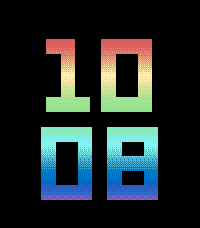</a>

<h2 class="app-name" id="app-8acbc29865ff44c4a54ba660"><a href="https://apps.repebble.com/8acbc29865ff44c4a54ba660">Prism</a> v1.0.0</h2>
<a class="app-source" href="https://github.com/ProggroP/Prism" title="Source code" data-search-exclude>View source</a>

Watchface

MIT Released 2026-10-10 Updated 2026-10-10

Runs on: Round 2, Time 2

A Pebble can show 64 colours. A rainbow needs a few more than that. Prism gets them by dithering: every pixel picks one of the two nearest colours the screen really has, in a fine ordered pattern…

<h2 class="app-name" id="app-30a024b52fcb4a42bcefe9db"><a href="https://apps.repebble.com/30a024b52fcb4a42bcefe9db">Ebb</a> v1.0.0</h2>
<a class="app-source" href="https://github.com/ProggroP/Ebb" title="Source code" data-search-exclude>View source</a>

Watchface

MIT Released 2026-10-10 Updated 2026-10-10

Runs on: Round 2, Time 2

Most digital watchfaces change the minute the way a light switch changes a room: one instant it is 10:07, the next it is 10:08. Ebb lets the time go out like a tide. Just before the minute turns…

<a class="app-shot" href="https://apps.repebble.com/0093694931ce41d1990ed50f" data-search-exclude>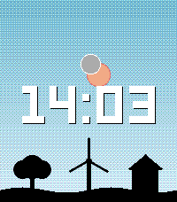</a>

<h2 class="app-name" id="app-0093694931ce41d1990ed50f"><a href="https://apps.repebble.com/0093694931ce41d1990ed50f">Solar &amp; Moon Arc</a> v2.2.0</h2>
<a class="app-source" href="https://github.com/ProggroP/SolarAndMoonArc" title="Source code" data-search-exclude>View source</a>

Watchface

MIT Released 2026-06-15 Updated 2026-10-03

Runs on: Round 2, Time 2, Time Round, Time

DESCRIPTION Watch the sky change through the day. The sun and moon move along curved paths based on your location, declination and time. They rise and set at the right horizon points and reach…

<a class="app-shot" href="https://apps.repebble.com/13356ca8c72a485383b0ac0d" data-search-exclude>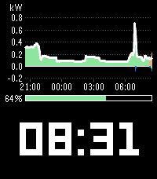</a>

<h2 class="app-name" id="app-13356ca8c72a485383b0ac0d"><a href="https://apps.repebble.com/13356ca8c72a485383b0ac0d">Power Sources</a> v1.0.0</h2>
<a class="app-source" href="https://github.com/ProggroP/PowerSources" title="Source code" data-search-exclude>View source</a>

Watchface

MIT Released 2026-09-30 Updated 2026-09-30

Runs on: Round 2, Time 2

Power Sources puts the power sources graph from the Home Assistant energy dashboard on your watch, right above the time. At a glance you see where your power has been coming from: solar, battery…

<a class="app-shot" href="https://apps.repebble.com/e3b0b14c08f14504b8dfa36c" data-search-exclude>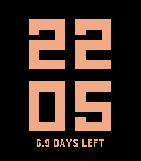</a>

<h2 class="app-name" id="app-e3b0b14c08f14504b8dfa36c"><a href="https://apps.repebble.com/e3b0b14c08f14504b8dfa36c">Coast</a> v1.4.0</h2>
<a class="app-source" href="https://github.com/ProggroP/Coast" title="Source code" data-search-exclude>View source</a>

Watchface

MIT Released 2026-09-10 Updated 2026-09-26

Runs on: Round 2, Time 2, Pebble 2 Duo, Pebble 2, Time Round, Time, Classic

Most watchfaces redraw the screen every minute. A face with a second hand redraws it 86,400 times a day. Coast redraws it 288 times - and if you ask it to, only 96. It does that by rounding. The…

<a class="app-shot" href="https://apps.repebble.com/a0fb0204f76146a8bfd81bc9" data-search-exclude>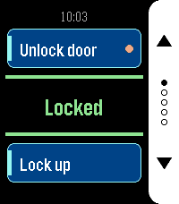</a>

<h2 class="app-name" id="app-a0fb0204f76146a8bfd81bc9"><a href="https://apps.repebble.com/a0fb0204f76146a8bfd81bc9">HA Trigger</a> v1.2.0</h2>
<a class="app-source" href="https://github.com/ProggroP/HATrigger" title="Source code" data-search-exclude>View source</a>

App

MIT Released 2026-09-09 Updated 2026-09-21

Runs on: Round 2, Time 2

HA Trigger puts Home Assistant actions on your wrist and keeps the answer in front of you. Each screen carries two actions: the top button runs one, the bottom button the other. Between them sits…

<h2 class="app-name" id="app-5984653d0dfc3275e20008d5"><a href="https://apps.repebble.com/5984653d0dfc3275e20008d5">Fix</a> v2.1.0</h2>
<a class="app-source" href="https://github.com/ProggroP/Fix" title="Source code" data-search-exclude>View source</a>

Watchface

MIT Released 2017-08-04 Updated 2026-09-21

Runs on: Round 2, Time 2, Pebble 2 Duo, Pebble 2, Time Round, Time, Classic

Fix turns the watch into a set of rolling drums. The numbers travel along a wide arc and a single horizontal line points at the one that counts right now — the way a tuning dial or an odometer…

<h2 class="app-name" id="app-ecd9ad3bca11441bb516f008"><a href="https://apps.repebble.com/ecd9ad3bca11441bb516f008">LED Watch</a> v1.0.0</h2>
<a class="app-source" href="https://github.com/ProggroP/LEDWatch" title="Source code" data-search-exclude>View source</a>

Watchface

MIT Released 2026-09-07 Updated 2026-09-07

Runs on: Time 2

LED Watch brings back the column display of a binary LED wristwatch — and makes it readable. Four columns stand side by side, twelve rows tall, counting upwards from the bottom: the hour in blue…

<a class="app-shot" href="https://apps.repebble.com/ab473533d2654972bc6abaf9" data-search-exclude>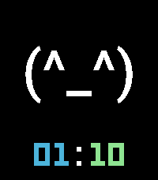</a>

<h2 class="app-name" id="app-ab473533d2654972bc6abaf9"><a href="https://apps.repebble.com/ab473533d2654972bc6abaf9">ASCII Mood</a> v1.0.0</h2>
<a class="app-source" href="https://github.com/ProggroP/AsciiMood" title="Source code" data-search-exclude>View source</a>

Watchface

MIT Released 2026-09-05 Updated 2026-09-05

Runs on: Round 2, Time 2

ASCII Mood puts a text emoticon on your wrist at full size — the face fills the display, and the clock steps back into a quiet line underneath it. Eight moods are built in, from `(^_^)` to…

<a class="app-shot" href="https://apps.repebble.com/e8110b3976c3415ea30ac10b" data-search-exclude>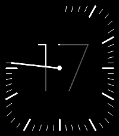</a>

<h2 class="app-name" id="app-e8110b3976c3415ea30ac10b"><a href="https://apps.repebble.com/e8110b3976c3415ea30ac10b">Afterglow</a> v1.0.0</h2>
<a class="app-source" href="https://github.com/ProggroP/Afterglow" title="Source code" data-search-exclude>View source</a>

Watchface

MIT Released 2026-08-30 Updated 2026-08-30

Runs on: Round 2, Time 2

Afterglow shows the hour as a single large numeral in hairline type — and then lets the minutes eat into it. A slender hand sweeps clockwise from twelve. Behind it the minute marks appear one by…

<a class="app-shot" href="https://apps.repebble.com/dc854d62378441fb88d04a19" data-search-exclude>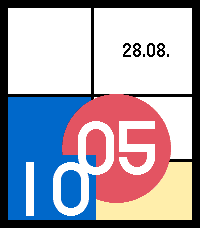</a>

<h2 class="app-name" id="app-dc854d62378441fb88d04a19"><a href="https://apps.repebble.com/dc854d62378441fb88d04a19">Bauhaus</a> v1.0.0</h2>
<a class="app-source" href="https://github.com/ProggroP/Bauhaus" title="Source code" data-search-exclude>View source</a>

Watchface

MIT Released 2026-08-28 Updated 2026-08-28

Runs on: Round 2, Time 2

Bauhaus turns the time into an abstract composition. A red disc carries the hour and stands where that hour falls on the dial. A blue field carries the minute. A black rule travels once around the…

<h2 class="app-name" id="app-57c9bc503a274ae58646c263"><a href="https://apps.repebble.com/57c9bc503a274ae58646c263">HA Watch</a> v1.2.0</h2>
<a class="app-source" href="https://github.com/ProggroP/HAWatch" title="Source code" data-search-exclude>View source</a>

Watchface

MIT Released 2026-08-25 Updated 2026-08-27

Runs on: Round 2, Time 2

A complete watchface, with room for your Home Assistant. Out of the box it works on its own: date, sunrise and sunset for wherever you are, the time, the current weather, your step count and…

<a class="app-shot" href="https://apps.repebble.com/58172e1e46041f64b00002b7" data-search-exclude>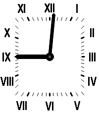</a>

<h2 class="app-name" id="app-58172e1e46041f64b00002b7"><a href="https://apps.repebble.com/58172e1e46041f64b00002b7">Your Style</a> v2.3.1</h2>
<a class="app-source" href="https://github.com/ProggroP/YourStyle" title="Source code" data-search-exclude>View source</a>

Watchface

No licence Released 2016-10-31 Updated 2026-08-19

Runs on: Round 2, Time 2, Pebble 2 Duo, Pebble 2, Time Round, Time

Configure your watchface as you like it. All possible colors for your model can be applied to the watchface elements. Hide hour and minute marks, enable seconds if you like that. Fullscreen option…

<a class="app-shot" href="https://apps.repebble.com/c195775b96b545279595143f" data-search-exclude>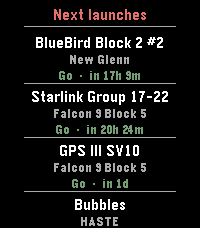</a>

<h2 class="app-name" id="app-c195775b96b545279595143f"><a href="https://apps.repebble.com/c195775b96b545279595143f">LaunchPad</a> v1.1.1</h2>
<a class="app-source" href="https://github.com/ProggroP/LaunchPad" title="Source code" data-search-exclude>View source</a>

App

MIT Released 2026-04-18 Updated 2026-08-04

Runs on: Round 2, Time 2

LaunchPad brings the world&#x27;s rocket launch schedule to your Pebble. Scroll through the next 10 upcoming orbital launches, each showing: * Mission name — what&#x27;s flying (BlueBird, Starlink, GPS III…

<a class="app-shot" href="https://apps.repebble.com/71497f50c97544eb908f46ad" data-search-exclude>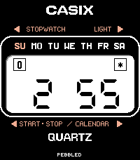</a>

<h2 class="app-name" id="app-71497f50c97544eb908f46ad"><a href="https://apps.repebble.com/71497f50c97544eb908f46ad">Casix</a> v2.1</h2>
<a class="app-source" href="https://www.github.com/ProggroP/casix" title="Source code" data-search-exclude>View source</a>

Watchface

Released 2026-05-14 Updated 2026-06-30

Runs on: Round 2, Time 2, Pebble 2 Duo, Pebble 2, Time Round, Time, Classic

Casix Some watches are just tools. Others become part of who you are. This watchface is a tribute to my very first quartz watch — a Casio from the late 1970s that I wore every single day for…

<a class="app-shot" href="https://apps.repebble.com/5936a75cb67f9f88a6000ae4" data-search-exclude>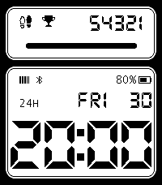</a>

<h2 class="app-name" id="app-5936a75cb67f9f88a6000ae4"><a href="https://apps.repebble.com/5936a75cb67f9f88a6000ae4">91 Steps &amp; Heart Rate</a> v2.8.0</h2>
<a class="app-source" href="https://github.com/ProggroP/91StepsHeart" title="Source code" data-search-exclude>View source</a>

Watchface

Other Released 2017-06-06 Updated 2026-06-28

Runs on: Round 2, Time 2, Pebble 2 Duo, Pebble 2, Time Round, Time, Classic

Inspired by and partly based on 91 Dub (thanks for the great watchface!), this watchface displays real-time sensor data. The configuration includes a daily step goal, a 12-hour format option, and…

<a class="app-shot" href="https://apps.repebble.com/fed3349de367448b92ca4f2a" data-search-exclude>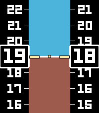</a>

<h2 class="app-name" id="app-fed3349de367448b92ca4f2a"><a href="https://apps.repebble.com/fed3349de367448b92ca4f2a">PFD</a> v1.1.1</h2>
<a class="app-source" href="https://github.com/ProggroP/PFD" title="Source code" data-search-exclude>View source</a>

Watchface

No licence Released 2026-06-13 Updated 2026-06-13

Runs on: Round 2, Time 2, Pebble 2 Duo, Pebble 2, Time Round, Time, Classic

coming soon

<a class="app-shot" href="https://apps.repebble.com/2fbd6661cc6a48d18690e77f" data-search-exclude>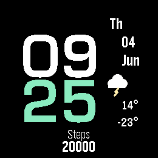</a>

<h2 class="app-name" id="app-2fbd6661cc6a48d18690e77f"><a href="https://apps.repebble.com/2fbd6661cc6a48d18690e77f">Aurora</a> v1.2.0</h2>
<a class="app-source" href="https://github.com/ProggroP/Aurora" title="Source code" data-search-exclude>View source</a>

Watchface

No licence Released 2026-06-04 Updated 2026-06-10

Runs on: Round 2, Time Round

text

<a class="app-shot" href="https://apps.repebble.com/7650810547de4df2a41991e7" data-search-exclude>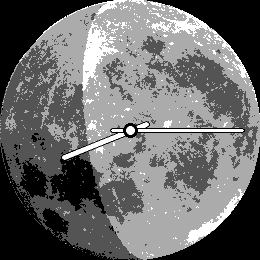</a>

<h2 class="app-name" id="app-7650810547de4df2a41991e7"><a href="https://apps.repebble.com/7650810547de4df2a41991e7">MoonFace</a> v1.1</h2>
<a class="app-source" href="https://github.com/ProggroP/MoonFace" title="Source code" data-search-exclude>View source</a>

Watchface

No licence Released 2026-06-02 Updated 2026-06-02

Runs on: Round 2, Time Round

A real moon on your wrist. Moonface shows the current lunar phase as a soft shadow over a full-disk moon, turned to match how the Moon actually appears in your local sky. Features: Full-disk moon…

<h2 class="app-name" id="app-89428bc020ae4ee7af64469d"><a href="https://apps.repebble.com/89428bc020ae4ee7af64469d">Marquee</a> v1.3</h2>
<a class="app-source" href="https://github.com/ProggroP/Marquee" title="Source code" data-search-exclude>View source</a>

App

No licence Released 2026-05-18 Updated 2026-05-31

Runs on: Round 2, Time 2, Pebble 2 Duo, Pebble 2, Time Round, Time, Classic

Marquee Got something you need to glance at quickly? Marquee shows any text you want right on your wrist — always visible, no fumbling with your phone. Perfect for: 🔑 Door and gate PIN codes 📶…

<h2 class="app-name" id="app-6b9efe0bec8746bfba20ad7e"><a href="https://apps.repebble.com/6b9efe0bec8746bfba20ad7e">Limb</a> v1.0</h2>
<a class="app-source" href="https://github.com/ProggroP/Limb" title="Source code" data-search-exclude>View source</a>

Watchface

No licence Released 2026-05-19 Updated 2026-05-19

Runs on: Round 2, Time 2, Pebble 2 Duo, Pebble 2, Time Round, Time, Classic

Limb reimagines the classic clock face by placing its centre beyond the screen edge. Only the limb of the dial is visible — a gently curved arc carrying two or three hour numerals, a bold minute…

