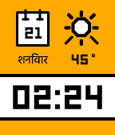

<!-- Generated by scripts/update_app_directory.py: do not edit by hand -->
[← All Pebble Developers](../developers.md)

# Kiezel

*2 watchfaces · Last updated 2026-10-11 · [About these lists](../about-app-lists.md)*

Links: [Pebble App Store](https://apps.repebble.com/apps/dev/kiezel_558e3fd4e3975e527b000055)

<button type="button" data-filter="all" aria-pressed="true">All 2</button><button type="button" data-filter="watchface" aria-pressed="false">Watchfaces 2</button><button type="button" data-filter="watchapp" aria-pressed="false" disabled>Apps 0</button>

<label class="dev-sort">Sort by <select><option value="updated">Recently updated</option><option value="released">Newest release</option><option value="title">A–Z</option></select></label>

<h2 class="app-name" id="app-56e706c3be2259f5c8000013"><a href="https://apps.repebble.com/56e706c3be2259f5c8000013">Essential Hindi</a> v1.1</h2>
<a class="app-source" href="https://www.kiezelwatchfaces.com" title="Source code" data-search-exclude>View source</a>

Watchface

Released 2016-03-14 Updated 2016-03-20

Runs on: Round 2, Time 2, Pebble 2 Duo, Pebble 2, Time Round, Time, Classic

Kiezel Watchfaces | Essential Hindi This is a paid watch-face. You can purchase this face individually for $0.99 or purchase our entire collection of 20+ faces for $5.99. You can purchase within…

<h2 class="app-name" id="app-559d7bdbfbb136b202000053"><a href="https://apps.repebble.com/559d7bdbfbb136b202000053">Squared Around</a> v1.0</h2>
<a class="app-source" href="https://www.kiezelwatchfaces.com/" title="Source code" data-search-exclude>View source</a>

Watchface

Released 2015-07-08 Updated 2015-07-08

Runs on: Time 2, Pebble 2 Duo, Pebble 2, Time, Classic

Kiezel Watchfaces | Squared Around This is a paid watch-face. You can purchase this face individually for $0.99 or purchase our entire collection of 20+ faces for $5.99. You can purchase within…

