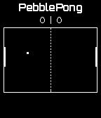

<!-- Generated by scripts/update_app_directory.py: do not edit by hand -->
[← All Pebble Developers](../developers.md)

# kije-dev

*1 watchface and 1 app · Last updated 2026-10-11 · [About these lists](../about-app-lists.md)*

Links: [Pebble App Store](https://apps.repebble.com/apps/dev/kije-dev_52b953e7fd4763c452000066) · [GitHub (kije)](https://github.com/kije) · [Website (kije.github.io)](http://kije.github.io/PebblePong-2/)

<button type="button" data-filter="all" aria-pressed="true">All 2</button><button type="button" data-filter="watchface" aria-pressed="false">Watchfaces 1</button><button type="button" data-filter="watchapp" aria-pressed="false">Apps 1</button>

<label class="dev-sort">Sort by <select><option value="updated">Recently updated</option><option value="released">Newest release</option><option value="title">A–Z</option></select></label>

<h2 class="app-name" id="app-52cb23ccb138287fc8000050"><a href="https://apps.repebble.com/52cb23ccb138287fc8000050">NextTrain</a> v1</h2>
<a class="app-source" href="https://github.com/kije/NextTrain" title="Source code" data-search-exclude>View source</a>

Watchface

Released 2014-01-06 Updated 2014-05-11

Runs on: Time 2, Pebble 2 Duo, Pebble 2, Time, Classic

A Pebble watchface, that shows you the next public transportations (bus, tram, train, etc...) departing from or nearby your current location. It will also notify you about delays and cancelations…

<h2 class="app-name" id="app-52b961505dfb6ed2b400005d"><a href="https://apps.repebble.com/52b961505dfb6ed2b400005d">PebblePong</a> v2.0.2</h2>
<a class="app-source" href="https://github.com/kije/PebblePong-2" title="Source code" data-search-exclude>View source</a>

App

Released 2013-12-24 Updated 2014-01-18

Runs on: Time 2, Pebble 2 Duo, Pebble 2, Time, Classic

Pong for Pebble Now with accelerometer support. Simply control your paddle by turning your wrist. To reset the calibration of the accelerometer during the game, press the select (middle) button on…

