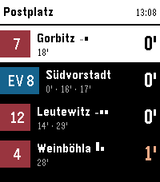

<!-- Generated by scripts/update_app_directory.py: do not edit by hand -->
[← All Pebble Developers](../developers.md)

# Kilian Koeltzsch

*1 app · Last updated 2026-10-12 · [About these lists](../about-app-lists.md)*

Links: [Pebble App Store](https://apps.repebble.com/apps/dev/kilian-koeltzsch_56a0fcf7a7d3b05d2609ce61) · [GitHub (kiliankoe)](https://github.com/kiliankoe)

<h2 class="app-name" id="app-c5a2a3ecd8ac487ab39411d8"><a href="https://apps.repebble.com/c5a2a3ecd8ac487ab39411d8">DVB</a> v1.2.0</h2>
<a class="app-source" href="https://github.com/kiliankoe/dvbpb" title="Source code" data-search-exclude>View source</a>

App

Released 2026-07-23 Updated 2026-07-26

Runs on: Round 2, Time 2, Pebble 2 Duo, Pebble 2, Time Round, Time

Navigate Dresden&#x27;s public transport network from your wrist. This app shows you upcoming departures for stops around you. You can also view and follow a specific trip. On opening the app it shows…

