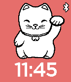

<!-- Generated by scripts/update_app_directory.py: do not edit by hand -->
[← All Pebble Developers](../developers.md)

# King Pi

*1 watchface · Last updated 2026-10-11 · [About these lists](../about-app-lists.md)*

Links: [Pebble App Store](https://apps.repebble.com/apps/dev/king-pi_5299671fe627cef8d7000011) · [GitHub (pi-king)](https://github.com/pi-king)

<h2 class="app-name" id="app-52996cdc129af72b9d00002b"><a href="https://apps.repebble.com/52996cdc129af72b9d00002b">Maneki Neko Watch</a> v2.10</h2>
<a class="app-source" href="https://github.com/pi-king/manekineko" title="Source code" data-search-exclude>View source</a>

Watchface

Released 2013-11-30 Updated 2016-12-02

Runs on: Round 2, Time 2, Pebble 2 Duo, Pebble 2, Time Round, Time, Classic

Cute maneki neko(lucky cat) on your watch and bring good luck to you:) Beckoning and move mouth every minute. Through configuration page, user can - set background color - set text color - enable…

