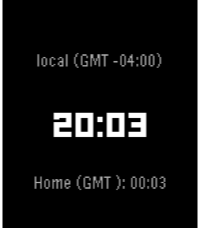

<!-- Generated by scripts/update_app_directory.py: do not edit by hand -->
[← All Pebble Developers](../developers.md)

# kinncj

*1 watchface and 1 app · Last updated 2026-10-12 · [About these lists](../about-app-lists.md)*

Links: [Rebble App Store](https://apps.rebble.io/en_US/developer/538e5df5702ddb4e0e000025/1) · [GitHub (kinncj)](https://github.com/kinncj)

<button type="button" data-filter="all" aria-pressed="true">All 2</button><button type="button" data-filter="watchface" aria-pressed="false">Watchfaces 1</button><button type="button" data-filter="watchapp" aria-pressed="false">Apps 1</button>

<label class="dev-sort">Sort by <select><option value="updated">Recently updated</option><option value="released">Newest release</option><option value="title">A–Z</option></select></label>

<h2 class="app-name" id="app-68c60a4e361d4900088efa99"><a href="https://apps.rebble.io/en_US/application/68c60a4e361d4900088efa99">Timezone Traveler</a> v2.0</h2>
<a class="app-source" href="https://github.com/kinncj/pebble-traveler" title="Source code" data-search-exclude>View source</a>

App

Released 2025-09-14 Updated 2025-09-14 Rebble App Store

Runs on: Round 2, Time 2, Pebble 2 Duo, Pebble 2, Time Round, Time

A clean and modern GMT watch face with simple functionality. Tap to seamlessly switch between your configured time zones. More details at http://github.com/kinncj/pebble-traveler. PS: Looking for…

<h2 class="app-name" id="app-68c374793bebfb0009a84e89"><a href="https://apps.rebble.io/en_US/application/68c374793bebfb0009a84e89">Timezone Traveler</a> v4.0</h2>
<a class="app-source" href="https://github.com/kinncj/pebble-traveler" title="Source code" data-search-exclude>View source</a>

Watchface

Released 2025-09-12 Updated 2025-09-13 Rebble App Store

Runs on: Round 2, Time 2, Pebble 2 Duo, Pebble 2, Time Round, Time

A clean and modern GMT watch face with simple functionality. Tap to seamlessly switch between your configured time zones. More details at http://github.com/kinncj/pebble-traveler PS: Looking for…

