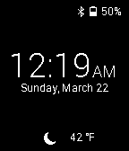

<!-- Generated by scripts/update_app_directory.py: do not edit by hand -->
[← All Pebble Developers](../developers.md)

# KJ Lawrence

*1 watchface · Last updated 2026-10-11 · [About these lists](../about-app-lists.md)*

Links: [Pebble App Store](https://apps.repebble.com/apps/dev/kj-lawrence_54fbb88ba3892f6af2000053) · [GitHub (kjlaw89)](https://github.com/kjlaw89)

<h2 class="app-name" id="app-550e454cad788cf90b0000ad"><a href="https://apps.repebble.com/550e454cad788cf90b0000ad">AndroidHome</a> v1.0</h2>
<a class="app-source" href="https://github.com/kjlaw89/Pebble-AndroidHome" title="Source code" data-search-exclude>View source</a>

Watchface

Released 2015-03-22 Updated 2015-03-22

Runs on: Time 2, Pebble 2 Duo, Pebble 2, Time, Classic

A simple watchface that takes visual cues from Android&#x27;s lockscreen. AndroidHome provides weather and bluetooth/battery statuses. Weather is provided by Forecast.io and needs an API key that can…

