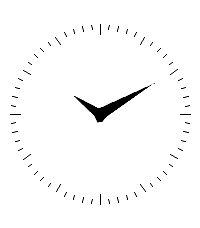
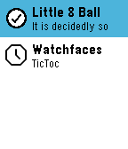

<!-- Generated by scripts/update_app_directory.py: do not edit by hand -->
[← All Pebble Developers](../developers.md)

# kjy00302

*2 watchfaces and 1 app · Last updated 2026-10-11 · [About these lists](../about-app-lists.md)*

Links: [Rebble App Store](https://apps.rebble.io/en_US/developer/5d8006bf831cc00001cfba22/1) · [GitHub (kjy00302)](https://github.com/kjy00302)

<button type="button" data-filter="all" aria-pressed="true">All 3</button><button type="button" data-filter="watchface" aria-pressed="false">Watchfaces 2</button><button type="button" data-filter="watchapp" aria-pressed="false">Apps 1</button>

<label class="dev-sort">Sort by <select><option value="updated">Recently updated</option><option value="released">Newest release</option><option value="title">A–Z</option></select></label>

<h2 class="app-name" id="app-692bf93b63df8c000980a4c0"><a href="https://apps.rebble.io/en_US/application/692bf93b63df8c000980a4c0">xclock</a> v1.1.0</h2>
<a class="app-source" href="https://github.com/kjy00302/pebble-xclock" title="Source code" data-search-exclude>View source</a>

Watchface · <a href="https://forum.rebble.io/t/1162" title="Discuss this app on the Rebble forum" data-search-exclude>Forum thread</a>

Released 2025-11-30 Updated 2026-07-17 Rebble App Store

Runs on: Round 2, Time 2, Pebble 2 Duo, Pebble 2, Time Round, Time, Classic

The classic analog clock for X windows system, ported to Pebble watchface.

<h2 class="app-name" id="app-67e3d4c37c483c000957c851"><a href="https://apps.rebble.io/en_US/application/67e3d4c37c483c000957c851">Fimally!</a> v1.1.0</h2>
<a class="app-source" href="https://github.com/kjy00302/pebble-fimally" title="Source code" data-search-exclude>View source</a>

Watchface · <a href="https://forum.rebble.io/t/1163" title="Discuss this app on the Rebble forum" data-search-exclude>Forum thread</a>

Released 2025-03-26 Updated 2026-07-17 Rebble App Store

Runs on: Round 2, Time 2, Pebble 2 Duo, Pebble 2, Time Round, Time, Classic

A watchface based on Obvious Plant&#x27;s Pre-Cracked egg.

<h2 class="app-name" id="app-67cc5a88b7a023024b2145b8"><a href="https://apps.rebble.io/en_US/application/67cc5a88b7a023024b2145b8">Little 8 Ball</a> v1.0</h2>
<a class="app-source" href="https://github.com/kjy00302/pebble-8ball-glance" title="Source code" data-search-exclude>View source</a>

App

Released 2025-03-08 Updated 2025-03-08 Rebble App Store

Runs on: Round 2, Time 2, Pebble 2 Duo, Pebble 2, Time Round, Time

Yet another experimental Magic 8 Ball app uses App Glance without any screens.

