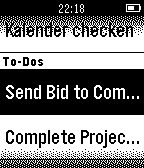

<!-- Generated by scripts/update_app_directory.py: do not edit by hand -->
[← All Pebble Developers](../developers.md)

# Klaus Demerath

*1 app · Last updated 2026-10-11 · [About these lists](../about-app-lists.md)*

Links: [Pebble App Store](https://apps.repebble.com/apps/dev/klaus-demerath_552b8a4f78b9cee33b0000ca) · [GitHub (kdemerath)](https://github.com/kdemerath)

<h2 class="app-name" id="app-55ddd1cb4374cb79f9000036"><a href="https://apps.repebble.com/55ddd1cb4374cb79f9000036">Habitica Tasks</a> v1.8</h2>
<a class="app-source" href="https://github.com/kdemerath/Habitica-Tasks" title="Source code" data-search-exclude>View source</a>

App

Released 2015-08-26 Updated 2019-07-24

Runs on: Round 2, Time 2, Pebble 2 Duo, Pebble 2, Time Round, Time, Classic

This watchapp lets you access your habitica (aka habitRPG) tasks and mark them completed. Select a task in the tasks list and press &#x27;select&#x27;. The selected tasks get IMMEDIATELY marked as completed…

