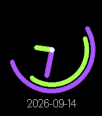

<!-- Generated by scripts/update_app_directory.py: do not edit by hand -->
[← All Pebble Developers](../developers.md)

# kleines Filmröllchen

*1 watchface · Last updated 2026-10-11 · [About these lists](../about-app-lists.md)*

Links: [Pebble App Store](https://apps.repebble.com/apps/dev/kleines-filmr-llchen_4488a38e63f0048709d457de) · [Codeberg (filmroellchen)](https://codeberg.org/filmroellchen) · [Website (filmroellchen.eu)](https://filmroellchen.eu/projects/webapps/p5jsclock/)

<h2 class="app-name" id="app-2dbaa9b069e84efeb1bb9cac"><a href="https://apps.repebble.com/2dbaa9b069e84efeb1bb9cac">Circular Analog Clock</a> v0.1.0</h2>
<a class="app-source" href="https://codeberg.org/filmroellchen/pebble-circular-analog-clock" title="Source code" data-search-exclude>View source</a>

Watchface

Released 2026-09-14 Updated 2026-09-14

Runs on: Round 2, Time 2, Pebble 2 Duo, Pebble 2, Time Round, Time, Classic

Pebble port of the minimalistic colorful analog clock with decorative and functional arcs: https://filmroellchen.eu/projects/webapps/p5jsclock/ Main difference to the Web version: Omitted seconds…

