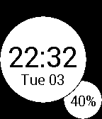

<!-- Generated by scripts/update_app_directory.py: do not edit by hand -->
[← All Pebble Developers](../developers.md)

# Kleverson Royther

*1 watchface · Last updated 2026-10-11 · [About these lists](../about-app-lists.md)*

Links: [Pebble App Store](https://apps.repebble.com/apps/dev/kleverson-royther_541861a0e2f3419e51000043) · [GitHub (KRoyther)](https://github.com/KRoyther)

<h2 class="app-name" id="app-54f672ad414e76a3320000a4"><a href="https://apps.repebble.com/54f672ad414e76a3320000a4">Circles</a> v0.7</h2>
<a class="app-source" href="http://github.com/KRoyther/Circle" title="Source code" data-search-exclude>View source</a>

Watchface

No licence Released 2015-03-04 Updated 2015-03-05

Runs on: Time 2, Pebble 2 Duo, Pebble 2, Time, Classic

Circles is a watchface inspired by elements of Material Design. In this first version, it currently shows: 1: The time; 2: Short day of the week and day of the month; 3: Battery percentage (w/…

