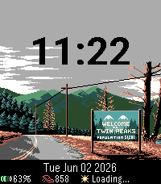
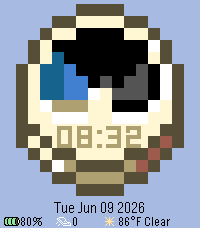
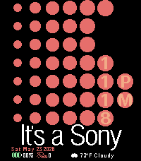

<!-- Generated by scripts/update_app_directory.py: do not edit by hand -->
[← All Pebble Developers](../developers.md)

# Knfn

*3 watchfaces · Last updated 2026-10-11 · [About these lists](../about-app-lists.md)*

Links: [Pebble App Store](https://apps.repebble.com/apps/dev/knfn_0db81fab88481ed6a3fe7381) · [GitHub (Knucklesfan)](https://github.com/Knucklesfan)

<button type="button" data-filter="all" aria-pressed="true">All 3</button><button type="button" data-filter="watchface" aria-pressed="false">Watchfaces 3</button><button type="button" data-filter="watchapp" aria-pressed="false" disabled>Apps 0</button>

<label class="dev-sort">Sort by <select><option value="updated">Recently updated</option><option value="released">Newest release</option><option value="title">A–Z</option></select></label>

<h2 class="app-name" id="app-03a7c81cfce647e7b2391cd0"><a href="https://apps.repebble.com/03a7c81cfce647e7b2391cd0">Welcome to Twin Peaks</a> v4.0.0</h2>
<a class="app-source" href="https://github.com/knucklesfan/pebble-watchfaces" title="Source code" data-search-exclude>View source</a>

Watchface

Released 2026-06-03 Updated 2026-09-30

Runs on: Time 2

It is happening again... Step Counter, Date/Time, Weather, and Battery. A damn fine watchface. Art originally drawn by https://www.deviantart.com/bbrunomoraes/art/Twin-Peaks-1-2-673906909! Damn…

<h2 class="app-name" id="app-02b3679008fc47c5b37ef8f8"><a href="https://apps.repebble.com/02b3679008fc47c5b37ef8f8">Minecraft Clock</a> v1.0.0</h2>
<a class="app-source" href="https://github.com/Knucklesfan/pebble-watchfaces/tree/main/mcclock" title="Source code" data-search-exclude>View source</a>

Watchface

GPL-3.0 Released 2026-06-10 Updated 2026-06-10

Runs on: Round 2, Time 2

The clock from Minecraft! Has Date, Time, automatically updating clock like in game, Steps, Weather and Battery indicators! Alongside this, it is fully customizable, so you can customize it as…

<h2 class="app-name" id="app-10fe23168dbe4573a7fe20cc"><a href="https://apps.repebble.com/10fe23168dbe4573a7fe20cc">It&#x27;s a Sony</a> v2.0.1</h2>
<a class="app-source" href="https://github.com/Knucklesfan/pebble-watchfaces/tree/main/itsasony" title="Source code" data-search-exclude>View source</a>

Watchface

GPL-3.0 Released 2026-05-24 Updated 2026-06-03

Runs on: Time 2

The classic Sony branding; on your wrist! It&#x27;s like a wrist-based Walkman, basically. Has Weather, Time, Date, Steps, and Battery.

