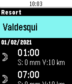
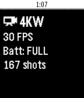
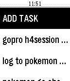

<!-- Generated by scripts/update_app_directory.py: do not edit by hand -->
[← All Pebble Developers](../developers.md)

# Konrad Iturbe

*4 apps · Last updated 2026-10-12 · [About these lists](../about-app-lists.md)*

Links: [Pebble App Store](https://apps.repebble.com/apps/dev/konrad-iturbe_554fa8d38d6d430fd500006d) · [GitHub (konradit)](https://github.com/konradit) · [Website (chernowii.com)](http://chernowii.com)

<button type="button" data-filter="all" aria-pressed="true">All 4</button><button type="button" data-filter="watchface" aria-pressed="false" disabled>Watchfaces 0</button><button type="button" data-filter="watchapp" aria-pressed="false">Apps 4</button>

<label class="dev-sort">Sort by <select><option value="updated">Recently updated</option><option value="released">Newest release</option><option value="title">A–Z</option></select></label>

<h2 class="app-name" id="app-601b22a11342ae01cc2e3fb1"><a href="https://apps.repebble.com/601b22a11342ae01cc2e3fb1">Slope Buddy</a> v0.1</h2>
<a class="app-source" href="https://github.com/konradit/slopebuddy" title="Source code" data-search-exclude>View source</a>

App

Released 2021-02-03 Updated 2021-02-03

Runs on: Round 2, Time 2, Pebble 2 Duo, Pebble 2, Time Round, Time, Classic

Slope Buddy tells you what you need to know before heading out to ski. See the weather 1-7 days ahead, see how much fresh snow there&#x27;ll be at the top of the resort, see which lifts are open and…

<h2 class="app-name" id="app-57ef907a05e4b17e1c000186"><a href="https://apps.repebble.com/57ef907a05e4b17e1c000186">GoPro Remote</a> v1.4</h2>
<a class="app-source" href="http://github.com/konradit/HEROPebble" title="Source code" data-search-exclude>View source</a>

App

No licence Released 2016-10-01 Updated 2021-01-30

Runs on: Round 2, Time 2, Pebble 2 Duo, Pebble 2, Time Round, Time, Classic

A GoPro Remote for Pebble. Works with: - (Partially) GoPro HERO3 and HERO3+ - GoPro HERO4 Black/Silver - GoPro HERO4 Session - GoPro HERO5 Black/Session - GoPro HERO+ and HERO+ LCD - GoPro HERO6 …

<h2 class="app-name" id="app-579f8f9f22f599f05b00055f"><a href="https://apps.repebble.com/579f8f9f22f599f05b00055f">pInTheAM - TaskWarrior Client</a> v1.0-rbl1</h2>
<a class="app-source" href="http://github.com/KonradIT/pebble-taskwarrior" title="Source code" data-search-exclude>View source</a>

App

No licence Released 2016-08-01 Updated 2019-07-24

Runs on: Round 2, Time 2, Pebble 2 Duo, Pebble 2, Time Round, Time, Classic

pInTheAM is a Taskwarrior client for Pebble watches. You need a active Inthe.AM account synced with Taskwarrior. Features: - View all tasks - Set task complete, start task, stop task and delete…

<h2 class="app-name" id="app-57c43fca5e3c3db6280003a9"><a href="https://apps.repebble.com/57c43fca5e3c3db6280003a9">Shutter</a> v1.0</h2>
<a class="app-source" href="http://github.com/konradit/shutter" title="Source code" data-search-exclude>View source</a>

App

No licence Released 2016-08-29 Updated 2016-08-29

Runs on: Round 2, Time 2, Pebble 2 Duo, Pebble 2, Time Round, Time, Classic

FOR ROOTED DEVICES ONLY. This app allows you to take a photo on your Android phone It emulates touchscreen press on the app&#x27;s shutter button and takes a picture/starts or stops a video. Android…

