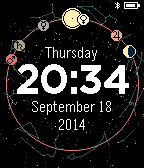

<!-- Generated by scripts/update_app_directory.py: do not edit by hand -->
[← All Pebble Developers](../developers.md)

# Konstantin Beliakov

*1 watchface · Last updated 2026-10-12 · [About these lists](../about-app-lists.md)*

Links: [Rebble App Store](https://apps.rebble.io/en_US/developer/53e9cc82f4772adc670000ae/1) · [GitHub (konstantinbelyakov)](https://github.com/konstantinbelyakov) · [Website (ecliptic-pebble.blogspot.com)](http://ecliptic-pebble.blogspot.com)

<h2 class="app-name" id="app-54250a8d5394589fee0000d3"><a href="https://apps.rebble.io/en_US/application/54250a8d5394589fee0000d3">Ecliptic</a> v3.1</h2>
<a class="app-source" href="https://github.com/konstantinbelyakov/ecliptic-pebble" title="Source code" data-search-exclude>View source</a>

Watchface

Released 2014-09-26 Updated 2015-10-23 Rebble App Store

Runs on: Round 2, Time 2, Pebble 2 Duo, Pebble 2, Time Round, Time, Classic

Do you like astronomy or simply want an unusual watchface? Use Ecliptic - it displays positions of the Sun, the Moon, stars and five brightest planets of the solar system that are visible with the…

