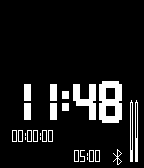

<!-- Generated by scripts/update_app_directory.py: do not edit by hand -->
[← All Pebble Developers](../developers.md)

# Konstantin

*1 app · Last updated 2026-10-11 · [About these lists](../about-app-lists.md)*

Links: [Pebble App Store](https://apps.repebble.com/apps/dev/konstantin_52c2054401696b65f40000ca) · [Website (plus.google.com)](https://plus.google.com/communities/113697555385343423777)

<h2 class="app-name" id="app-549e223cef9cfaabe000004b"><a href="https://apps.repebble.com/549e223cef9cfaabe000004b">TilesApp</a> v1.29</h2>
<a class="app-source" href="https://bitbucket.org/kvorobyev/pebbletiles" title="Source code" data-search-exclude>View source</a>

App

Released 2014-12-27 Updated 2015-09-12

Runs on: Time 2, Pebble 2 Duo, Pebble 2, Time, Classic

Create your own watchface for Pebble by arranging tiles(widgets)

