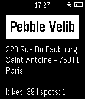

<!-- Generated by scripts/update_app_directory.py: do not edit by hand -->
[← All Pebble Developers](../developers.md)

# Kovaxlabs

*1 app · Last updated 2026-10-11 · [About these lists](../about-app-lists.md)*

Links: [Pebble App Store](https://apps.repebble.com/apps/dev/kovaxlabs_5454da5fe77c14f021000086) · [GitHub (AlexKovax)](https://github.com/AlexKovax) · [Website (kovaxlabs.com)](http://www.kovaxlabs.com)

<h2 class="app-name" id="app-549ee1d3ef9cfa427a00018c"><a href="https://apps.repebble.com/549ee1d3ef9cfa427a00018c">Paris Velib Finder</a> v1.0</h2>
<a class="app-source" href="https://github.com/AlexKovax/PebbleVelib" title="Source code" data-search-exclude>View source</a>

App

GPL-2.0 Released 2014-12-27 Updated 2014-12-27

Runs on: Time 2, Pebble 2 Duo, Pebble 2, Time, Classic

Paris Velib Finder is a very simplistic app that gives you the address of the closest Velib station in Paris and the available bikes/spots number. That&#x27;s it!

