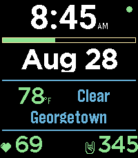

<!-- Generated by scripts/update_app_directory.py: do not edit by hand -->
[← All Pebble Developers](../developers.md)

# kPebble

*1 watchface · Last updated 2026-10-12 · [About these lists](../about-app-lists.md)*

Links: [Pebble App Store](https://apps.repebble.com/apps/dev/kpebble_4fb2188be2d93da972cfc9ae) · [GitHub (kooscode)](https://github.com/kooscode)

<h2 class="app-name" id="app-da0dc9441cf34e9dba801da6"><a href="https://apps.repebble.com/da0dc9441cf34e9dba801da6">kface</a> v1.0.2</h2>
<a class="app-source" href="https://github.com/kooscode/kface" title="Source code" data-search-exclude>View source</a>

Watchface

Released 2026-08-22 Updated 2026-08-28

Runs on: Time 2

kface — A clean, minimal watchface for Pebble Time 2. Time and date up top, a battery meter, live weather (temp, condition, and city — pulled via your phone&#x27;s location and Open-Meteo), your heart…

