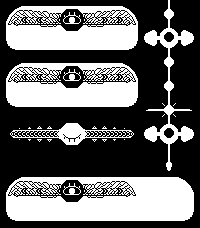
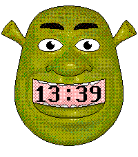

<!-- Generated by scripts/update_app_directory.py: do not edit by hand -->
[← All Pebble Developers](../developers.md)

# Krang

*2 watchfaces · Last updated 2026-10-11 · [About these lists](../about-app-lists.md)*

Links: [Pebble App Store](https://apps.repebble.com/apps/dev/krang_6a50573dc423ad0008ec935c) · [Codeberg (Krang)](https://codeberg.org/Krang)

<button type="button" data-filter="all" aria-pressed="true">All 2</button><button type="button" data-filter="watchface" aria-pressed="false">Watchfaces 2</button><button type="button" data-filter="watchapp" aria-pressed="false" disabled>Apps 0</button>

<label class="dev-sort">Sort by <select><option value="updated">Recently updated</option><option value="released">Newest release</option><option value="title">A–Z</option></select></label>

<h2 class="app-name" id="app-6a855a3b2e9a5c0009ed2eb7"><a href="https://apps.repebble.com/6a855a3b2e9a5c0009ed2eb7">Binary Bold</a> v0.0.5</h2>
<a class="app-source" href="https://codeberg.org/Krang/Binary_Bold_for_Pebble" title="Source code" data-search-exclude>View source</a>

Watchface · <a href="https://forum.rebble.io/t/1253" title="Discuss this app on the Rebble forum" data-search-exclude>Forum thread</a>

Released 2026-08-19 Updated 2026-10-02

Runs on: Round 2, Time 2, Pebble 2 Duo, Pebble 2, Time, Classic

A binary watch face with a focus on readability. Hours are displayed using four large bits. The most significant bit (32) is wider so you can tell which direction to read in. Minutes are displayed…

<h2 class="app-name" id="app-6a505ed550bd250009c6bd8f"><a href="https://apps.repebble.com/6a505ed550bd250009c6bd8f">Shrek Watch</a> v1.4.6</h2>
<a class="app-source" href="https://codeberg.org/Krang/Shrek_Watch_for_Pebble" title="Source code" data-search-exclude>View source</a>

Watchface · <a href="https://forum.rebble.io/t/1141" title="Discuss this app on the Rebble forum" data-search-exclude>Forum thread</a>

Released 2026-07-10 Updated 2026-08-07

Runs on: Round 2, Time 2, Pebble 2 Duo, Pebble 2, Time, Classic

It&#x27;s Shrek! The mouth opens and closes on the minute. Supports date. Supports 12h and 24h time formats. Supports BW watches, Pebble Time 2 and Pebble Round 2. More to come soon. Design based on…

