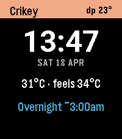
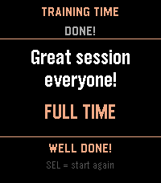
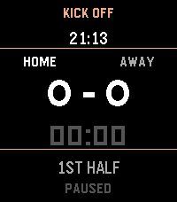

<!-- Generated by scripts/update_app_directory.py: do not edit by hand -->
[← All Pebble Developers](../developers.md)

# Kris Gesling

*1 watchface and 2 apps · Last updated 2026-10-11 · [About these lists](../about-app-lists.md)*

Links: [Pebble App Store](https://apps.repebble.com/apps/dev/kris-gesling_390504aecfed84534cb9437b) · [GitHub (krisgesling)](https://github.com/krisgesling)

<button type="button" data-filter="all" aria-pressed="true">All 3</button><button type="button" data-filter="watchface" aria-pressed="false">Watchfaces 1</button><button type="button" data-filter="watchapp" aria-pressed="false">Apps 2</button>

<label class="dev-sort">Sort by <select><option value="updated">Recently updated</option><option value="released">Newest release</option><option value="title">A–Z</option></select></label>

<h2 class="app-name" id="app-9b18ecf408b74964b7d72786"><a href="https://apps.repebble.com/9b18ecf408b74964b7d72786">Sweat Factor</a> v1.2.1</h2>
<a class="app-source" href="https://github.com/krisgesling/pebble-sweat-factor" title="Source code" data-search-exclude>View source</a>

Watchface

Released 2026-04-13 Updated 2026-06-12

Runs on: Time 2

A Pebble watchface for tropical climates. Where temperature is nearly meaningless. Dew point and rain timing are what you actually care about.

<h2 class="app-name" id="app-ee2719042ba540b9a8b48408"><a href="https://apps.repebble.com/ee2719042ba540b9a8b48408">Training Time</a> v1.0</h2>
<a class="app-source" href="https://github.com/krisgesling/pebble-training-time" title="Source code" data-search-exclude>View source</a>

App

Released 2026-04-04 Updated 2026-04-04

Runs on: Time 2

app for running kids soccer training sessions. Build a session plan on your phone, then work through it on your wrist - activity by activity, with countdown timers, haptic alerts, and on-the-fly…

<h2 class="app-name" id="app-edd90fe5fe5f47cd91e8cb68"><a href="https://apps.repebble.com/edd90fe5fe5f47cd91e8cb68">Kick Off</a> v1.0</h2>
<a class="app-source" href="https://github.com/krisgesling/pebble-kick-off" title="Source code" data-search-exclude>View source</a>

App

Released 2026-04-04 Updated 2026-04-04

Runs on: Time 2

A simple football (soccer) game tracking app, perfect for kids game day.

