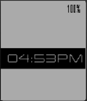

<!-- Generated by scripts/update_app_directory.py: do not edit by hand -->
[← All Pebble Developers](../developers.md)

# Kunalpod

*1 watchface · Last updated 2026-10-12 · [About these lists](../about-app-lists.md)*

Links: [Pebble App Store](https://apps.repebble.com/apps/dev/kunalpod_54d0dbb3dec337644f000099) · [GitHub (Kunalpod)](https://github.com/Kunalpod)

<h2 class="app-name" id="app-557eb7fcbb3773ef7d000008"><a href="https://apps.repebble.com/557eb7fcbb3773ef7d000008">Minimal Clean</a> v1.1</h2>
<a class="app-source" href="https://github.com/Kunalpod/minimalclean" title="Source code" data-search-exclude>View source</a>

Watchface

No licence Released 2015-06-15 Updated 2015-06-16

Runs on: Time 2, Pebble 2 Duo, Pebble 2, Time, Classic

New watch-face. As minimal as possible. Please do contact me for any feedback.

