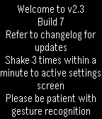
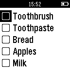

<!-- Generated by scripts/update_app_directory.py: do not edit by hand -->
[← All Pebble Developers](../developers.md)

# Kurt Lawrence

*2 watchfaces and 2 apps · Last updated 2026-10-12 · [About these lists](../about-app-lists.md)*

Links: [Pebble App Store](https://apps.repebble.com/apps/dev/kurt-lawrence_55c95471a29d99642d00002d) · [GitHub (kurtlawrence)](https://github.com/kurtlawrence)

<button type="button" data-filter="all" aria-pressed="true">All 4</button><button type="button" data-filter="watchface" aria-pressed="false">Watchfaces 2</button><button type="button" data-filter="watchapp" aria-pressed="false">Apps 2</button>

<label class="dev-sort">Sort by <select><option value="updated">Recently updated</option><option value="released">Newest release</option><option value="title">A–Z</option></select></label>

<h2 class="app-name" id="app-55d1b7047e217af6e4000075"><a href="https://apps.repebble.com/55d1b7047e217af6e4000075">Astronomy Face</a> v2.3</h2>
<a class="app-source" href="https://github.com/kurtlawrence/PebbleWatch_Astronomy_Face" title="Source code" data-search-exclude>View source</a>

Watchface

Released 2015-08-17 Updated 2016-02-21

Runs on: Time 2, Pebble 2 Duo, Pebble 2, Time, Classic

Displays interesting location based data like compass heading and bearing, sun rise and set times, moon rise and phase, battery status, and GPS coordinates, along with time and date data. Does not…

<h2 class="app-name" id="app-55f6642c701b34da31000041"><a href="https://apps.repebble.com/55f6642c701b34da31000041">Mnemosyne Elixir</a> v2.0</h2>
<a class="app-source" href="https://github.com/kurtlawrence/AndroidShoppingList_pebble" title="Source code" data-search-exclude>View source</a>

App

Released 2015-09-14 Updated 2015-10-17

Runs on: Round 2, Time 2, Pebble 2 Duo, Pebble 2, Time Round, Time, Classic

A useful checklist app that will move checked items out of the way when checked. The app is designed for shopping or todo applications, position unchecked items at the top of the stack for ease of…

<h2 class="app-name" id="app-55e14bb75895cb0baf0000fc"><a href="https://apps.repebble.com/55e14bb75895cb0baf0000fc">Chemistry Face</a> v2.0</h2>
<a class="app-source" href="https://github.com/kurtlawrence/PebbleWatch_Chemistry_Face" title="Source code" data-search-exclude>View source</a>

Watchface

Released 2015-08-29 Updated 2015-10-17

Runs on: Round 2, Time 2, Pebble 2 Duo, Pebble 2, Time Round, Time, Classic

Displays the current time and date (in DD-MM-YY) as atomic elements in a clean watch face. Shake to peek at the integer values which can help you memorise those elements!

<h2 class="app-name" id="app-55e6e8b7049482285e00000d"><a href="https://apps.repebble.com/55e6e8b7049482285e00000d">Astronomy App</a> v1.1</h2>
<a class="app-source" href="https://github.com/kurtlawrence/PebbleWatch_Astronomy_App" title="Source code" data-search-exclude>View source</a>

App

Released 2015-09-02 Updated 2015-09-22

Runs on: Time 2, Pebble 2 Duo, Pebble 2, Time, Classic

Track the solar system bodies without any internet connection! Can be used to find compass heading and inclinometer, whilst display current azimuth and altitude of a heavenly body. For moon rise…

