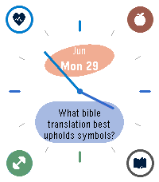

<!-- Generated by scripts/update_app_directory.py: do not edit by hand -->
[← All Pebble Developers](../developers.md)

# Kyle

*1 watchface · Last updated 2026-10-12 · [About these lists](../about-app-lists.md)*

Links: [Pebble App Store](https://apps.repebble.com/apps/dev/kyle_1182399db3efa5360c7687b1) · [GitHub (tuortheblessed)](https://github.com/tuortheblessed)

<h2 class="app-name" id="app-5334b6e1a5a8451ea24534d4"><a href="https://apps.repebble.com/5334b6e1a5a8451ea24534d4">Hey Calendar</a> v1.0.9</h2>
<a class="app-source" href="https://github.com/tuortheblessed/pebble-watchfaces" title="Source code" data-search-exclude>View source</a>

Watchface

Released 2026-06-27 Updated 2026-06-30

Runs on: Time 2

Hey habits, todos, and calendar on your Pebble Time 2. Need to get an auth key from your Hey account via a computer terminal. Instructions in the watchface settings.

