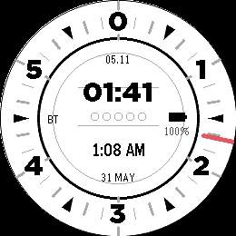

<!-- Generated by scripts/update_app_directory.py: do not edit by hand -->
[← All Pebble Developers](../developers.md)

# Lallander

*1 watchface · Last updated 2026-10-12 · [About these lists](../about-app-lists.md)*

Links: [Pebble App Store](https://apps.repebble.com/apps/dev/lallander_39e74a1e1cc9556461815155) · [GitHub (Lallander)](https://github.com/Lallander)

<h2 class="app-name" id="app-7ff21e904edc4b3bbd5e0b5e"><a href="https://apps.repebble.com/7ff21e904edc4b3bbd5e0b5e">36 Hour Clock</a> v1.0.1</h2>
<a class="app-source" href="https://github.com/Lallander/36-Hour-Clock-PR2/" title="Source code" data-search-exclude>View source</a>

Watchface

MIT Released 2026-05-31 Updated 2026-05-31

Runs on: Round 2

A simple watch face for the Pebble Round 2 that shows 36 hour time alongside standard 24/12 hour time. Heximal Metric Time.

