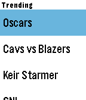
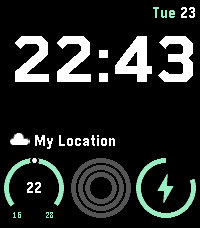
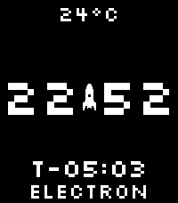
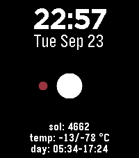

<!-- Generated by scripts/update_app_directory.py: do not edit by hand -->
[← All Pebble Developers](../developers.md)

# lamasters

*3 watchfaces and 1 app · Last updated 2026-10-11 · [About these lists](../about-app-lists.md)*

Links: [Pebble App Store](https://apps.repebble.com/apps/dev/lamasters_5ca7f156835c6200017635d5) · [Rebble App Store](https://apps.rebble.io/en_US/developer/5ca7f156835c6200017635d5/1) · [GitHub (lamasters)](https://github.com/lamasters)

<button type="button" data-filter="all" aria-pressed="true">All 4</button><button type="button" data-filter="watchface" aria-pressed="false">Watchfaces 3</button><button type="button" data-filter="watchapp" aria-pressed="false">Apps 1</button>

<label class="dev-sort">Sort by <select><option value="updated">Recently updated</option><option value="released">Newest release</option><option value="title">A–Z</option></select></label>

<h2 class="app-name" id="app-67c3a3e6d2acb30009a3c7ba"><a href="https://apps.repebble.com/67c3a3e6d2acb30009a3c7ba">Pebblsky</a> v1.97</h2>
<a class="app-source" href="https://github.com/lamasters/pebblsky" title="Source code" data-search-exclude>View source</a>

App · <a href="https://forum.rebble.io/t/1291" title="Discuss this app on the Rebble forum" data-search-exclude>Forum thread</a>

Released 2025-03-02 Updated 2026-10-06

Runs on: Round 2, Time 2, Pebble 2 Duo, Pebble 2, Time Round, Time, Classic

Browse your pinned feeds and stay up to date with what people are talking about with the latest trending topics from Bluesky. Support my work https://ko-fi.com/lamasters Thanks to denden1088 in…

<h2 class="app-name" id="app-67cb26bdb7a02301b9a6e426"><a href="https://apps.repebble.com/67cb26bdb7a02301b9a6e426">Modulus</a> v1.27</h2>
<a class="app-source" href="https://github.com/lamasters/modulus-watchface" title="Source code" data-search-exclude>View source</a>

Watchface · <a href="https://forum.rebble.io/t/971" title="Discuss this app on the Rebble forum" data-search-exclude>Forum thread</a>

Released 2025-03-07 Updated 2026-06-24

Runs on: Time 2, Pebble 2 Duo, Pebble 2, Time, Classic

A simple face with weather and fitness tracking. Customize it to match your colours! Inspired by the Apple Watch Modular face. Support my work https://ko-fi.com/lamasters The outer fitness ring is…

<h2 class="app-name" id="app-67bb8c49691e55000aa48cd8"><a href="https://apps.repebble.com/67bb8c49691e55000aa48cd8">Wrist Rocket</a> v1.22</h2>
<a class="app-source" href="https://github.com/lamasters/wrist-rocket" title="Source code" data-search-exclude>View source</a>

Watchface

Released 2025-02-23 Updated 2025-09-24

Runs on: Round 2, Time 2, Pebble 2 Duo, Pebble 2, Time Round, Time, Classic

Wrist Rocket gives you a countdown to the next rocket that will be launched into space! See when it will be launched and what type of rocket it is. Support my work https://ko-fi.com/lamasters

<h2 class="app-name" id="app-67c34f7fd2acb30009a3c7a5"><a href="https://apps.rebble.io/en_US/application/67c34f7fd2acb30009a3c7a5">Curiosity Climate</a> v1.22</h2>
<a class="app-source" href="https://github.com/lamasters/curiosity-climate" title="Source code" data-search-exclude>View source</a>

Watchface

Released 2025-03-01 Updated 2025-09-07 Rebble App Store

Runs on: Round 2, Time 2, Pebble 2 Duo, Pebble 2, Time Round, Time

Ever wondered what those little robots are up to on Mars? Get the latest weather updates from the curiosity rover while you watch Mars orbit the sun every hour.

