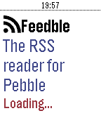

<!-- Generated by scripts/update_app_directory.py: do not edit by hand -->
[← All Pebble Developers](../developers.md)

# Lander Laparra

*1 app · Last updated 2026-10-11 · [About these lists](../about-app-lists.md)*

Links: [Rebble App Store](https://apps.rebble.io/en_US/developer/5840820b00355a0a12000063/1) · [GitHub (lapitzasclub)](https://github.com/lapitzasclub)

<h2 class="app-name" id="app-5866a69f2ee4312381000245"><a href="https://apps.rebble.io/en_US/application/5866a69f2ee4312381000245">Feedble</a> v1.8</h2>
<a class="app-source" href="https://github.com/lapitzasclub/Feedble" title="Source code" data-search-exclude>View source</a>

App

Released 2016-12-30 Updated 2017-01-18 Rebble App Store

Runs on: Round 2, Time 2, Pebble 2 Duo, Pebble 2, Time Round, Time, Classic

A CommaFeed (https://www.commafeed.com) news reader (RSS) for Pebble.

