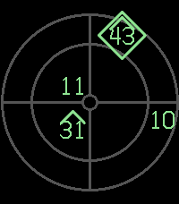
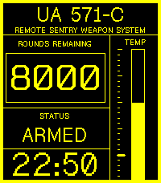
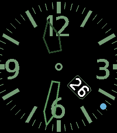

<!-- Generated by scripts/update_app_directory.py: do not edit by hand -->
[← All Pebble Developers](../developers.md)

# Lars Falk-Petersen

*3 watchfaces · Last updated 2026-11-02 · [About these lists](../about-app-lists.md)*

Links: [Pebble App Store](https://apps.repebble.com/apps/dev/lars-falk-petersen_97cf75e57e2e5ab198e65df0) · [GitLab (larsfp)](https://gitlab.com/larsfp) · [Website (falkp.no)](https://falkp.no)

<button type="button" data-filter="all" aria-pressed="true">All 3</button><button type="button" data-filter="watchface" aria-pressed="false">Watchfaces 3</button><button type="button" data-filter="watchapp" aria-pressed="false" disabled>Apps 0</button>

<label class="dev-sort">Sort by <select><option value="updated">Recently updated</option><option value="released">Newest release</option><option value="title">A–Z</option></select></label>

<h2 class="app-name" id="app-0e5ccc837bdc4fc18892de74"><a href="https://apps.repebble.com/0e5ccc837bdc4fc18892de74">RWR</a> v1.7.0</h2>
<a class="app-source" href="https://gitlab.com/larsfp/rebble-rwr" title="Source code" data-search-exclude>View source</a>

Watchface · <a href="https://forum.rebble.io/t/1441" title="Discuss this app on the Rebble forum" data-search-exclude>Forum thread</a>

No licence Released 2026-10-18 Updated 2026-10-31

Runs on: Round 2, Time 2, Pebble 2 Duo, Pebble 2, Time Round, Time, Classic

&quot;Radar Warning Receiver&quot; watchface, for aviation geeks. Unfortunately the radar hardware is lacking in most Pebble models, so four random contacts representing time and date are shown. Colors…

<h2 class="app-name" id="app-ffcf7095efe544df8272ab82"><a href="https://apps.repebble.com/ffcf7095efe544df8272ab82">UA 571-C</a> v1.1.0</h2>
<a class="app-source" href="https://gitlab.com/larsfp/ua571c" title="Source code" data-search-exclude>View source</a>

Watchface

No licence Released 2026-10-26 Updated 2026-10-28

Runs on: Time 2

A watchface with focus on obtaining your daily step goal. It&#x27;s also a homage to one the fantastic user interfaces in the Alien franchise, the UA 571-C Remote Sentry Weapon System. - Ammo counter =…

<h2 class="app-name" id="app-f6d36dafc1d740e0bc876f90"><a href="https://apps.repebble.com/f6d36dafc1d740e0bc876f90">TH10me</a> v1.1.0</h2>
<a class="app-source" href="https://gitlab.com/larsfp/th10me" title="Source code" data-search-exclude>View source</a>

Watchface

agpl-3.0 Released 2026-10-26 Updated 2026-10-28

Runs on: Round 2, Time 2, Pebble 2 Duo, Pebble 2, Time Round, Time, Classic

The original TH10c seems abandoned, so I recreated it. Features - Adjustable colors for dial/numerals, hour hand, minute hand, seconds dot, and date. - Optional solid hands: fill the hour and…

