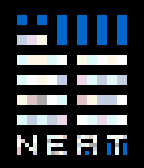
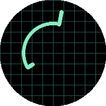

<!-- Generated by scripts/update_app_directory.py: do not edit by hand -->
[← All Pebble Developers](../developers.md)

# lastfuture

*3 watchfaces · Last updated 2026-10-11 · [About these lists](../about-app-lists.md)*

Links: [Pebble App Store](https://apps.repebble.com/apps/dev/lastfuture_52f00cd8e523d0248c00000d) · [GitHub (lastfuture)](https://github.com/lastfuture) · [Website (git.broken.graphics)](https://git.broken.graphics/alina/Pebble-Time-Watchface-Squared-4.0)

<button type="button" data-filter="all" aria-pressed="true">All 3</button><button type="button" data-filter="watchface" aria-pressed="false">Watchfaces 3</button><button type="button" data-filter="watchapp" aria-pressed="false" disabled>Apps 0</button>

<label class="dev-sort">Sort by <select><option value="updated">Recently updated</option><option value="released">Newest release</option><option value="title">A–Z</option></select></label>

<h2 class="app-name" id="app-52f014d342937dc4430000ee"><a href="https://apps.repebble.com/52f014d342937dc4430000ee">Squared 4.0</a> v4.15</h2>
<a class="app-source" href="https://github.com/lastfuture/Pebble-Time-Watchface-Squared-4.0" title="Source code" data-search-exclude>View source</a>

Watchface

Released 2014-02-03 Updated 2016-11-22

Runs on: Round 2, Time 2, Pebble 2 Duo, Pebble 2, Time Round, Time, Classic

A slick collection of squares showing you time and date. Customize colors and appearance. Choose any color combination and preview the result right away. You decide on the date format, if you want…

<h2 class="app-name" id="app-5647661dcadadbd23900007f"><a href="https://apps.repebble.com/5647661dcadadbd23900007f">Super Simple</a> v1.8</h2>
<a class="app-source" href="https://github.com/lastfuture/Pebble-Time-Watchface-Super-Simple" title="Source code" data-search-exclude>View source</a>

Watchface

Released 2015-11-14 Updated 2015-12-20

Runs on: Round 2, Time 2, Pebble 2 Duo, Pebble 2, Time Round, Time, Classic

A Super Simple watchface with only two analog hands. Configure colors, shadows and tick marks to make it entirely your own.

<h2 class="app-name" id="app-564f8291331881d7d1000018"><a href="https://apps.repebble.com/564f8291331881d7d1000018">Arcangle</a> v1.3</h2>
<a class="app-source" href="https://github.com/lastfuture/Pebble-Time-Watchface-Arcangle" title="Source code" data-search-exclude>View source</a>

Watchface

Released 2015-11-20 Updated 2015-11-25

Runs on: Round 2, Time Round

A watchface for the hacker spy in you. Made exclusively for Pebble Time Round Examples: 8:01, 5:20, 8:17, 11:52 You read the start and the end of the line like regular watch hands, the piece…

