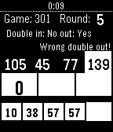

<!-- Generated by scripts/update_app_directory.py: do not edit by hand -->
[← All Pebble Developers](../developers.md)

# László Vass

*1 app · Last updated 2026-10-11 · [About these lists](../about-app-lists.md)*

Links: [Pebble App Store](https://apps.repebble.com/apps/dev/l-szl-vass_5610ec745f75c3435a000071) · [GitHub (vassdoki)](https://github.com/vassdoki) · [Website (facebook.com)](https://www.facebook.com/pebbleDartsScore/)

<h2 class="app-name" id="app-5821192334da21b8b400001e"><a href="https://apps.repebble.com/5821192334da21b8b400001e">Darts Score</a> v1.2</h2>
<a class="app-source" href="https://github.com/vassdoki/pebble-darts-counter" title="Source code" data-search-exclude>View source</a>

App

Released 2016-11-08 Updated 2016-11-23

Runs on: Round 2, Time 2, Pebble 2 Duo, Pebble 2, Time Round, Time, Classic

Just play your favorite X01 darts game, and keep the score using your pebble.

