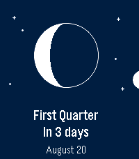

<!-- Generated by scripts/update_app_directory.py: do not edit by hand -->
[← All Pebble Developers](../developers.md)

# Laurent Dinclaux

*1 app · Last updated 2026-10-11 · [About these lists](../about-app-lists.md)*

Links: [Pebble App Store](https://apps.repebble.com/apps/dev/laurent-dinclaux_9496cb13574a3964b0079f36) · [GitHub (loxK)](https://github.com/loxK)

<h2 class="app-name" id="app-86a2d34ade9646dfb84d51af"><a href="https://apps.repebble.com/86a2d34ade9646dfb84d51af">Moon Phase</a> v1.1.1</h2>
<a class="app-source" href="https://github.com/loxK/Pebble-Moon-Phase" title="Source code" data-search-exclude>View source</a>

App

Released 2026-06-30 Updated 2026-08-23

Runs on: Round 2, Time 2, Pebble 2 Duo, Pebble 2, Time Round, Time, Classic

See the Moon exactly as it looks in the sky tonight — right on your wrist. Moon Phase draws the Moon the way you&#x27;d actually see it — the real illuminated shape, oriented for your hemisphere — then…

