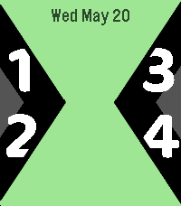
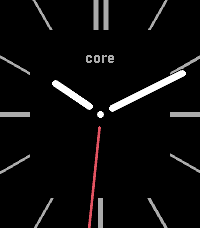
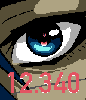

<!-- Generated by scripts/update_app_directory.py: do not edit by hand -->
[← All Pebble Developers](../developers.md)

# lavendork

*4 watchfaces · Last updated 2026-10-12 · [About these lists](../about-app-lists.md)*

Links: [Rebble App Store](https://apps.rebble.io/en_US/developer/5dcf62c7c393f5706985a9cb/1) · [GitHub (lavglaab)](https://github.com/lavglaab) · [Website (discord.com)](https://discord.com/channels/221364737269694464/1352777180764966975)

<button type="button" data-filter="all" aria-pressed="true">All 4</button><button type="button" data-filter="watchface" aria-pressed="false">Watchfaces 4</button><button type="button" data-filter="watchapp" aria-pressed="false" disabled>Apps 0</button>

<label class="dev-sort">Sort by <select><option value="updated">Recently updated</option><option value="released">Newest release</option><option value="title">A–Z</option></select></label>

<h2 class="app-name" id="app-6617645c46ea9f09c2b1558c"><a href="https://apps.rebble.io/en_US/application/6617645c46ea9f09c2b1558c">Minitrix2</a> v0.4.0</h2>
<a class="app-source" href="https://github.com/lavglaab/minitrix2-pebble/" title="Source code" data-search-exclude>View source</a>

Watchface · <a href="https://forum.rebble.io/t/989" title="Discuss this app on the Rebble forum" data-search-exclude>Forum thread</a>

Released 2024-04-11 Updated 2026-07-25 Rebble App Store

Runs on: Round 2, Time 2, Pebble 2 Duo, Pebble 2, Time Round, Time, Classic

The ultimate Ben 10 watch face for Pebble! A successor to my first Pebble watch face, with even cooler looks. Features: - Light changes color for Recharge Mode (low battery) and DNA Scan Mode…

<h2 class="app-name" id="app-5e9e37043dd3101b10109a01"><a href="https://apps.rebble.io/en_US/application/5e9e37043dd3101b10109a01">Moto Maker</a> v1.10</h2>
<a class="app-source" href="https://github.com/lavglaab/MotoMakerFace" title="Source code" data-search-exclude>View source</a>

Watchface · <a href="https://forum.rebble.io/t/332" title="Discuss this app on the Rebble forum" data-search-exclude>Forum thread</a>

Released 2020-04-20 Updated 2026-03-02 Rebble App Store

Runs on: Round 2, Time 2, Pebble 2 Duo, Pebble 2, Time Round, Time, Classic

A customizable analog watch face based on the look of the Moto 360, with plenty of color options.

<h2 class="app-name" id="app-65ee6ce8ea09ac0433d38125"><a href="https://apps.rebble.io/en_US/application/65ee6ce8ea09ac0433d38125">wake up_</a> v1.4</h2>
<a class="app-source" href="https://github.com/lavglaab/pebble-signalis-face" title="Source code" data-search-exclude>View source</a>

Watchface

Released 2024-03-11 Updated 2024-03-15 Rebble App Store

Runs on: Round 2, Time 2, Time Round, Time

A watch face for Pebble Time series watches, based on the title screen of the game SIGNALIS! Features: - 12 and 24 hour digital time - On-screen indicators for low battery, bluetooth disconnected…

<h2 class="app-name" id="app-5dcf62c8c393f5706985a9cd"><a href="https://apps.rebble.io/en_US/application/5dcf62c8c393f5706985a9cd">Minitrix</a> v1.3</h2>
<a class="app-source" href="https://github.com/lavglaab/MinitrixPebble" title="Source code" data-search-exclude>View source</a>

Watchface

Released 2019-11-16 Updated 2021-04-26 Rebble App Store

Runs on: Round 2, Time 2, Pebble 2 Duo, Pebble 2, Time Round, Time, Classic

A watch face inspired by the Omnitrix from Ben 10, with modes inspired by the classic series and Omniverse. Features analog and digital time, vibrate on phone disconnect, and changing color for…

