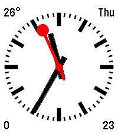

<!-- Generated by scripts/update_app_directory.py: do not edit by hand -->
[← All Pebble Developers](../developers.md)

# Lawrence Hon

*1 watchface · Last updated 2026-10-12 · [About these lists](../about-app-lists.md)*

Links: [Pebble App Store](https://apps.repebble.com/apps/dev/lawrence-hon_a158013fa933d51c1f0ab4d8) · [GitHub (lhon)](https://github.com/lhon)

<h2 class="app-name" id="app-95905503800f4e2a9669bb33"><a href="https://apps.repebble.com/95905503800f4e2a9669bb33">SwissCorners</a> v1.2.0</h2>
<a class="app-source" href="https://github.com/lhon/SwissCorners" title="Source code" data-search-exclude>View source</a>

Watchface

Released 2026-07-23 Updated 2026-07-28

Runs on: Round 2, Time 2, Pebble 2 Duo, Pebble 2, Time Round, Time, Classic

Swiss railway watchface with configurable corner complications This project is based on Maartje Eyskens’s ModernSwiss, which brought the classic “Swiss Square” face forward for reborn Pebble…

