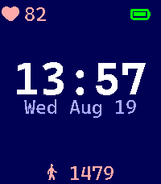

<!-- Generated by scripts/update_app_directory.py: do not edit by hand -->
[← All Pebble Developers](../developers.md)

# Laz

*1 watchface · Last updated 2026-10-12 · [About these lists](../about-app-lists.md)*

Links: [Pebble App Store](https://apps.repebble.com/apps/dev/laz_eeb16e199e809e04052f6723) · [GitHub (Lazken)](https://github.com/Lazken)

<h2 class="app-name" id="app-bc5427b437d44ced90b7f851"><a href="https://apps.repebble.com/bc5427b437d44ced90b7f851">pebbleCat</a> v1.0.1</h2>
<a class="app-source" href="https://github.com/Lazken/pebble-catppuccin" title="Source code" data-search-exclude>View source</a>

Watchface

No licence Released 2026-08-05 Updated 2026-08-19

Runs on: Time 2

Simple watchface using Catppuccin color palettes. Different Flavours can be chosen in settings. - Latte - Frappe - Macchiato - Mocha Font used is Caskaydia Cove Nerd Font. Heartrate and steps…

