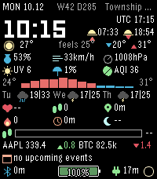
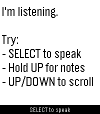

<!-- Generated by scripts/update_app_directory.py: do not edit by hand -->
[← All Pebble Developers](../developers.md)

# lazydevs

*1 watchface and 1 app · Last updated 2026-10-19 · [About these lists](../about-app-lists.md)*

Links: [Pebble App Store](https://apps.repebble.com/apps/dev/lazydevs_554c4a5c92dfd327380000c4) · [Codeberg (lazydevs)](https://codeberg.org/lazydevs) · [Codeberg (wristotle)](https://codeberg.org/wristotle) · [Website (wristotle.codeberg.page)](https://wristotle.codeberg.page/)

<button type="button" data-filter="all" aria-pressed="true">All 2</button><button type="button" data-filter="watchface" aria-pressed="false">Watchfaces 1</button><button type="button" data-filter="watchapp" aria-pressed="false">Apps 1</button>

<label class="dev-sort">Sort by <select><option value="updated">Recently updated</option><option value="released">Newest release</option><option value="title">A–Z</option></select></label>

<h2 class="app-name" id="app-fba3e0934e0e42b4ab774242"><a href="https://apps.repebble.com/fba3e0934e0e42b4ab774242">Readout</a> v1.0.1</h2>
<a class="app-source" href="https://codeberg.org/lazydevs/pebble-watchfaces" title="Source code" data-search-exclude>View source</a>

Watchface

Released 2026-10-12 Updated 2026-10-14

Runs on: Round 2, Time 2, Pebble 2 Duo, Pebble 2, Time Round, Time, Classic

A data-first watchface: a small clock and as many useful numbers as the screen will hold. Weather now with feels-like, low and high, humidity, wind, pressure, UV, rain chance and air quality, a…

<h2 class="app-name" id="app-6a0e71faced0bb000943bc90"><a href="https://apps.repebble.com/6a0e71faced0bb000943bc90">Wristotle</a> v1.8.0</h2>
<a class="app-source" href="https://codeberg.org/wristotle/wristotle" title="Source code" data-search-exclude>View source</a>

App · <a href="https://forum.rebble.io/t/990" title="Discuss this app on the Rebble forum" data-search-exclude>Forum thread</a>

Released 2026-05-21 Updated 2026-09-10

Runs on: Round 2, Time 2, Pebble 2 Duo, Pebble 2, Time Round, Time

Wristotle turns your Pebble&#x27;s dictation button into a voice command surface. Press the button, speak, and the Wristotle companion app on your Android phone handles it — calls, texts, reminders…

