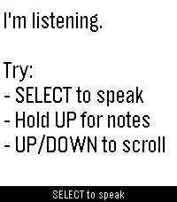

<!-- Generated by scripts/update_app_directory.py: do not edit by hand -->
[← All Pebble Developers](../developers.md)

# lazydevs

*1 app · Last updated 2026-10-12 · [About these lists](../about-app-lists.md)*

Links: [Pebble App Store](https://apps.repebble.com/apps/dev/lazydevs_554c4a5c92dfd327380000c4) · [Codeberg (wristotle)](https://codeberg.org/wristotle) · [Website (wristotle.codeberg.page)](https://wristotle.codeberg.page/)

<h2 class="app-name" id="app-6a0e71faced0bb000943bc90"><a href="https://apps.repebble.com/6a0e71faced0bb000943bc90">Wristotle</a> v1.8.0</h2>
<a class="app-source" href="https://codeberg.org/wristotle/wristotle" title="Source code" data-search-exclude>View source</a>

App · <a href="https://forum.rebble.io/t/990" title="Discuss this app on the Rebble forum" data-search-exclude>Forum thread</a>

Released 2026-05-21 Updated 2026-09-10

Runs on: Round 2, Time 2, Pebble 2 Duo, Pebble 2, Time Round, Time

Wristotle turns your Pebble&#x27;s dictation button into a voice command surface. Press the button, speak, and the Wristotle companion app on your Android phone handles it — calls, texts, reminders…

