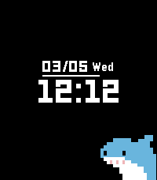

<!-- Generated by scripts/update_app_directory.py: do not edit by hand -->
[← All Pebble Developers](../developers.md)

# LCP

*1 watchface · Last updated 2026-10-11 · [About these lists](../about-app-lists.md)*

Links: [Rebble App Store](https://apps.rebble.io/en_US/developer/60871ca15a17be0054ba8699/1) · [GitHub (hellcp)](https://github.com/hellcp) · [Website (lcp.world)](https://lcp.world)

<h2 class="app-name" id="app-67c83368d2acb30009a3c841"><a href="https://apps.rebble.io/en_US/application/67c83368d2acb30009a3c841">CutieFur</a> v1.5</h2>
<a class="app-source" href="https://github.com/hellcp/cutiefur" title="Source code" data-search-exclude>View source</a>

Watchface · <a href="https://forum.rebble.io/t/1045" title="Discuss this app on the Rebble forum" data-search-exclude>Forum thread</a>

Released 2025-03-05 Updated 2026-06-11 Rebble App Store

Runs on: Round 2, Time 2, Pebble 2 Duo, Pebble 2, Time Round, Time, Classic

A watchface inspired by waniwatch by Mari Okada, with new set of animals and plenty of customizability.

