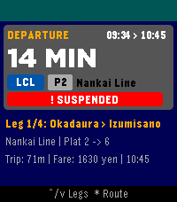

<!-- Generated by scripts/update_app_directory.py: do not edit by hand -->
[← All Pebble Developers](../developers.md)

# LeAtJapan

*1 app · Last updated 2026-10-11 · [About these lists](../about-app-lists.md)*

Links: [Pebble App Store](https://apps.repebble.com/apps/dev/leatjapan_a607d8b9d56aaf8e1f4abf00) · [GitHub (letrongnghiajp)](https://github.com/letrongnghiajp)

<h2 class="app-name" id="app-f4bcb24149f94952b206b6f0"><a href="https://apps.repebble.com/f4bcb24149f94952b206b6f0">Super Eki</a> v1.5.0</h2>
<a class="app-source" href="https://github.com/letrongnghiajp/ekisupa-pebble" title="Source code" data-search-exclude>View source</a>

App

Released 2026-08-24 Updated 2026-08-25

Runs on: Round 2, Time 2, Time Round, Time

A Pebble Time 2 transit assistant that provides real-time and scheduled train departures, countdowns, and service alerts from Ekispert.

