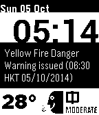

<!-- Generated by scripts/update_app_directory.py: do not edit by hand -->
[← All Pebble Developers](../developers.md)

# Lee Turner

*3 watchfaces · Last updated 2026-10-11 · [About these lists](../about-app-lists.md)*

Links: [Pebble App Store](https://apps.repebble.com/apps/dev/lee-turner_53058c84b704cb5227000071) · [GitHub (lvx3)](https://github.com/lvx3) · [Website (xyz.li)](http://xyz.li/)

<button type="button" data-filter="all" aria-pressed="true">All 3</button><button type="button" data-filter="watchface" aria-pressed="false">Watchfaces 3</button><button type="button" data-filter="watchapp" aria-pressed="false" disabled>Apps 0</button>

<label class="dev-sort">Sort by <select><option value="updated">Recently updated</option><option value="released">Newest release</option><option value="title">A–Z</option></select></label>

<h2 class="app-name" id="app-54310cabf1565e72f30000fc"><a href="https://apps.repebble.com/54310cabf1565e72f30000fc">Hong Kong Watchface</a> v1.1</h2>
<a class="app-source" href="https://github.com/lvx3/hkface" title="Source code" data-search-exclude>View source</a>

Watchface

Released 2014-10-05 Updated 2014-10-05

Runs on: Time 2, Pebble 2 Duo, Pebble 2, Time, Classic

Displays current weather warning, current air quality, current temperature for Hong Kong. Leave suggestions or bug reports in the source link! :-) I hope you find this watch face useful

<h2 class="app-name" id="app-53e63c5340d3d35e2700009a"><a href="https://apps.repebble.com/53e63c5340d3d35e2700009a">Saltire</a> v1.0</h2>
<a class="app-source" href="https://github.com/lvx3/pebble-saltire" title="Source code" data-search-exclude>View source</a>

Watchface

Released 2014-08-09 Updated 2014-08-09

Runs on: Time 2, Pebble 2 Duo, Pebble 2, Time, Classic

Scotland&#x27;s national flag, on your wrist.

<h2 class="app-name" id="app-53e618b7a9f4de431500008b"><a href="https://apps.repebble.com/53e618b7a9f4de431500008b">China AQI Watchface</a> v1.0.1</h2>
<a class="app-source" href="https://github.com/lvx3/china_aqi_watchface" title="Source code" data-search-exclude>View source</a>

Watchface

Released 2014-08-09 Updated 2014-08-09

Runs on: Time 2, Pebble 2 Duo, Pebble 2, Time, Classic

Gives the Displays the Air Quality Index (AQI) of the current Chinese city you are in on the bottom right of the screen and the current temperature in the bottom left. Data for AQI is from…

