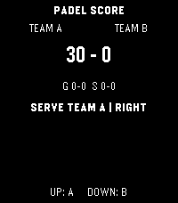

<!-- Generated by scripts/update_app_directory.py: do not edit by hand -->
[← All Pebble Developers](../developers.md)

# lefduti

*1 app · Last updated 2026-10-26 · [About these lists](../about-app-lists.md)*

Links: [Pebble App Store](https://apps.repebble.com/apps/dev/lefduti_fd2d593c3615d4dc67f42c31) · [GitHub (lefduti)](https://github.com/lefduti)

<h2 class="app-name" id="app-a3922d962536422493b7d533"><a href="https://apps.repebble.com/a3922d962536422493b7d533">Padel Score</a> v1.0.1</h2>
<a class="app-source" href="https://github.com/lefduti/padel-score-app" title="Source code" data-search-exclude>View source</a>

App

No licence Released 2026-10-19 Updated 2026-10-19

Runs on: Round 2, Time 2, Pebble 2 Duo, Pebble 2, Time Round, Time, Classic

Simple Padel App to track the score. - UP awards a point to Team A; - DOWN awards a point to Team B. - Hold UP or DOWN to undo the most recently awarded point. If the match is over, any button…

