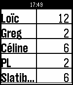

<!-- Generated by scripts/update_app_directory.py: do not edit by hand -->
[← All Pebble Developers](../developers.md)

# lehenry

*1 app · Last updated 2026-10-11 · [About these lists](../about-app-lists.md)*

Links: [Pebble App Store](https://apps.repebble.com/apps/dev/lehenry_54f7573d3aeaed913500008a) · [GitHub (lehenry)](https://github.com/lehenry)

<h2 class="app-name" id="app-56c8e1571261184eef000048"><a href="https://apps.repebble.com/56c8e1571261184eef000048">ScoreCards</a> v1.6</h2>
<a class="app-source" href="https://github.com/lehenry/ScoreCards" title="Source code" data-search-exclude>View source</a>

App

Released 2016-02-20 Updated 2016-06-27

Runs on: Round 2, Time 2, Pebble 2 Duo, Pebble 2, Time Round, Time, Classic

ScoreCards is a simple score tracking application for your dice/cards or boardgames - Set and order players in settings - Activate/Deactivate players - Choose first player (long select in &#x27;Set…

