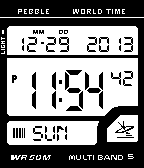

<!-- Generated by scripts/update_app_directory.py: do not edit by hand -->
[← All Pebble Developers](../developers.md)

# Leigh Murray

*1 watchface · Last updated 2026-10-12 · [About these lists](../about-app-lists.md)*

Links: [Pebble App Store](https://apps.repebble.com/apps/dev/leigh-murray_52c8e4112b59ec92d2000034) · [GitHub (leighmurray)](https://github.com/leighmurray) · [Website (forums.getpebble.com)](http://forums.getpebble.com/discussion/9687/watchface-sdk2-casio-wv-59-style-w-battery-level-bt-connection-indicator)

<h2 class="app-name" id="app-52cb5ae045ffdd5c5e0000b3"><a href="https://apps.repebble.com/52cb5ae045ffdd5c5e0000b3">59 dub</a> v1.2</h2>
<a class="app-source" href="https://github.com/leighmurray/Fifty-Nine-Dub" title="Source code" data-search-exclude>View source</a>

Watchface

Released 2014-01-07 Updated 2014-02-11

Runs on: Time 2, Pebble 2 Duo, Pebble 2, Time, Classic

This classic watch-face features an easy to read display with all your time and date information at a glance. - Vibrate every hour (optional in settings) - Year, Month, Date, Day, Hour, Minute…

