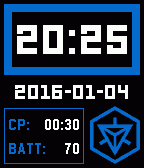

<!-- Generated by scripts/update_app_directory.py: do not edit by hand -->
[← All Pebble Developers](../developers.md)

# lenku

*1 watchface · Last updated 2026-10-11 · [About these lists](../about-app-lists.md)*

Links: [Pebble App Store](https://apps.repebble.com/apps/dev/lenku_55d85c3b6f697eced30000b7) · [GitHub (lenku)](https://github.com/lenku) · [Website (dutchx.me)](https://dutchx.me)

<h2 class="app-name" id="app-568a50ad142c4f161a000048"><a href="https://apps.repebble.com/568a50ad142c4f161a000048">IngressFace</a> v2.11</h2>
<a class="app-source" href="https://github.com/lenku/IngressFace" title="Source code" data-search-exclude>View source</a>

Watchface

Released 2016-01-04 Updated 2018-05-18

Runs on: Time 2, Pebble 2 Duo, Pebble 2, Time, Classic

The Ingress-inspired watchface for the Pebble and Pebble Time. An agent&#x27;s best friend! Always available on their wrist can be the most simple and essential of information one might need when going…

